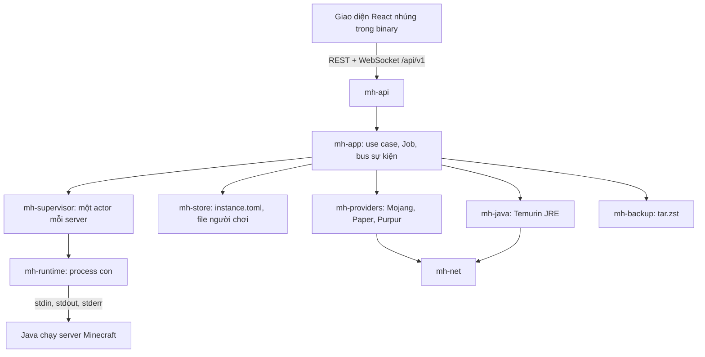

# Tổng quan kiến trúc

- Khớp code tới: 2026-11-11 (`origin/main` ở `6a03ff8`)
- Mô tả những gì **đang có trong code**. Dự định cho các giai đoạn sau nằm ở spec gốc và
  [backlog](../backlog.md).

## Một process, hai vai

MineHost là một binary `minehost` vừa là bảng điều khiển (API, giao diện web) vừa là trình chạy
server (spawn Java, đọc console). Không có daemon riêng trên máy khác và không có cơ sở dữ liệu:
trạng thái bền nằm trong thư mục dữ liệu ([du-lieu.md](du-lieu.md)), phần còn lại nằm trong RAM.



Bảng crate và quy tắc phụ thuộc: [AGENTS.md](../../AGENTS.md#kiến-trúc-crate). Chỉ `mh-app` được ghép
nhiều crate; `mh-core` không I/O.

## Luồng chính

**Tạo server** (Job `create` trong `mh-app`): kiểm tra ổ đĩa → lấy phiên bản từ Mojang và nguồn của loại
server (Paper, Purpur; Vanilla dùng jar của Mojang) →
`mh-java` tải Temurin JRE đúng major mà Mojang yêu cầu → tải `server.jar` có kiểm tra hash → ghi
`server.properties` và `instance.toml`. Lỗi hoặc hủy thì xóa thư mục tạo dở.

**Bật server:** actor của server gọi `AppLauncher::prepare` (kiểm tra EULA, ghi `server-port`, kiểm tra
cổng, bảo đảm có Java), rồi `mh-runtime` spawn:

```text
<java> -Xms<min>M -Xmx<max>M <5 cờ encoding UTF-8> <jvm_args trong instance.toml> -jar server.jar --nogui
```

Không có cờ GC nào do MineHost tự thêm. Actor chuyển sang `Running` khi thấy dòng log khớp `]: Done (`.

**Dừng:** gửi `stop` qua stdin, chờ tối đa 60 giây, quá hạn thì kill.

**Crash:** process thoát mà không ai yêu cầu. Nếu `restart_on_crash` thì bật lại sau 5, 15, 30 giây;
quá 3 lần trong 10 phút thì dừng ở `Crashed`, kèm 200 dòng log cuối và một `CrashHint` đoán từ 5 chuỗi
cố định trong log (`mh-core/src/crash.rs`).

**Console:** mỗi dòng có `seq` tăng dần; bộ đệm vòng 5.000 dòng trong RAM và file
`logs/console-YYYY-MM-DD.log` giữ 14 ngày. Giao diện kết nối lại bằng `seq` cuối đã nhận.

## Vòng đời controller và server

Quyết định: server dừng theo controller ([ADR 0001](../adr/0001-server-dung-theo-controller.md)).

| Tình huống | Điều xảy ra | Server có kịp lưu world không |
| --- | --- | --- |
| Nút Thoát (giao diện, khay), Ctrl+C, `SIGTERM` | `shutdown_all()`: gửi `stop` tới từng server, chờ, rồi thoát | Có |
| Controller crash hoặc bị kill | Windows: Job Object đóng, Java bị kết thúc ngay. Linux: `PR_SET_PDEATHSIG` gửi `SIGKILL` | **Không.** Mất phần chưa lưu kể từ lần autosave gần nhất |
| Tắt máy hoặc đăng xuất Windows | Controller không xử lý `WM_QUERYENDSESSION`; Windows kết thúc nó như trường hợp trên (suy từ code, chưa thử) | **Không** |
| Controller khởi động lại | Server còn file `.running` hoặc có `autostart = true` được bật lại | — |

Hai dòng "Không" là lỗ hổng đã biết, xem [rà soát 2026-11-11](../ra-soat/2026-11-11-kien-truc.md), mục A2.

## Giới hạn tài nguyên và cô lập

Hiện không có. Server là process con chạy cùng user với controller, giới hạn duy nhất là `-Xmx` của
JVM (giới hạn mềm, chỉ tính heap). Job Object trên Windows chỉ đặt cờ kill-khi-đóng, không đặt giới
hạn RAM hay CPU. Linux không dùng cgroup. Hệ quả về bảo mật: [bao-mat.md](bao-mat.md).

## Đang có và chưa có

| Phần | Trạng thái |
| --- | --- |
| Loại server | Paper, Purpur (kiểm tra md5), Vanilla (jar của Mojang). Mod loader: P3 |
| Runtime | Chỉ process con. Docker: P4 |
| Java | Temurin JRE do MineHost tải, chọn major theo Mojang. Không dùng Java có sẵn trên máy |
| Lưu trữ | File trên đĩa. Không có SQLite ([ADR 0004](../adr/0004-chua-dung-sqlite.md)) |
| Job | Trong RAM, giữ 50 Job gần nhất; mất khi controller tắt |
| Chỉ số | CPU, RAM, số người chơi; lấy mẫu mỗi 5 giây, giữ 1 giờ trong RAM |
| Tệp | Dịch vụ, route và trang Tệp (kèm trình sửa) đã có |
| Sao lưu | Nén, giải nén, Job sao lưu và Job khôi phục đã có; lịch, route, giao diện chưa có |
| Người chơi | Phân tích log, file JSON, sự kiện, hồ sơ Mojang, skin, điểm spawn đã có; API và giao diện chưa có |
| Đăng nhập, LAN | Mật khẩu admin (`auth.toml`, argon2id), phiên, CSRF, giới hạn đăng nhập sai đã có ở API; chưa có trang Đăng nhập và listener LAN. Hiện chỉ lắng nghe `127.0.0.1` |
| Chạy như service | Chưa có (P4). Cách tạm cho Linux: [ops/linux-systemd.md](../ops/linux-systemd.md) |

## Chỗ lệch với spec gốc

Spec gốc viết trước khi code. Các điểm dưới đây code (và spec giai đoạn) đã đi khác; code là bản đúng.

| Spec gốc viết | Thực tế |
| --- | --- |
| `mh-store` dùng SQLite qua `sqlx`, có bảng `servers`, `jobs`, `events`, `users` | Không có SQLite. Danh sách server lấy bằng cách quét `servers/*/instance.toml` ([ADR 0004](../adr/0004-chua-dung-sqlite.md)) |
| `mh-core` dùng `semver` | Phiên bản Minecraft là chuỗi không phân tích; thứ tự lấy từ `releaseTime` (spec P1 mục 3.5) |
| `enum Runtime { Process, Docker }` | Chỉ có `ProcessRuntime` |
| `mh-java` tìm Java có sẵn trên máy | Chỉ dùng Java do MineHost tải (spec P1 mục 3.2) |
| Lỗi có dạng `{ code, params, fix: { action, suggested } }` | Chỉ có `{ code, params }`. Gợi ý nằm trong `params`, ví dụ `suggested_port` |
| `GET/PUT/DELETE /servers/{id}/files/{*path}` | Đường dẫn đi trong query: `/servers/{id}/files?path=` và các route con ([api.md](api.md)) |
| WebSocket có topic `server.{id}.state`, `server.{id}.stats`, gửi mỗi 2 giây | Topic `servers` cho trạng thái; `server.<id>.metrics` gửi mỗi 5 giây |
| Sửa file bằng CodeMirror | Ô văn bản thường, không tô màu cú pháp (spec P2 mục 11) |
| Mỗi server có file `.lock` | Một khóa cho cả thư mục dữ liệu (`minehost.lock`), cộng dấu `.running` cho từng server |
| Phát hành bằng `cargo-dist`, có MSI, checksum và chữ ký | Workflow riêng: zip và tar.gz kèm `.sha256`, không ký ([ops/phat-hanh.md](../ops/phat-hanh.md)) |
| Test dùng `cargo-nextest`, `insta`; API thật chạy hằng đêm; fuzz hằng tuần | `cargo test`; không có workflow chạy theo lịch nào ([ops/kiem-thu-va-ci.md](../ops/kiem-thu-va-ci.md)) |
| CHANGELOG sinh tự động | Không có file CHANGELOG; ghi chú phát hành do GitHub sinh |
| Không chạy dưới root hoặc Administrator | Code không kiểm tra điều này |
| Chỉ tải từ danh sách domain được phép | `mh-net` không có danh sách domain; mỗi provider tự ghi URL. Riêng skin sẽ giới hạn domain (spec P2 mục 8) |
| P2 có bảng `users` | P2 chỉ có một mật khẩu admin, không có tài khoản |
