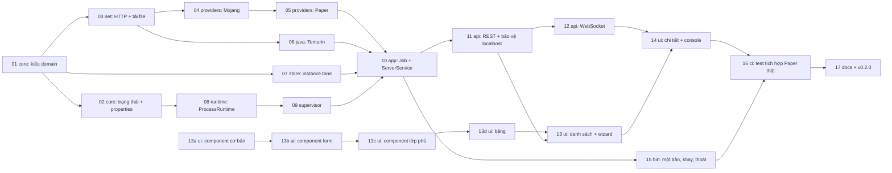

# Kế hoạch PR cho P1

Spec: [p1-mot-server-chay-duoc.md](p1-mot-server-chay-duoc.md). P1 được chia thành 17 PR. Mỗi PR làm
một việc, khoảng 400 dòng trở xuống (không tính fixture và code sinh tự động), có test, CI xanh mới merge.

## Thứ tự và phụ thuộc

Sau PR-01 và PR-02 có ba nhánh làm song song được, vì không đụng file của nhau:

- **A** (mạng): 03 → 04 → 05 và 03 → 06.
- **B** (lưu trữ): 07.
- **C** (chạy server): 08 → 09.

Ba nhánh gặp lại nhau ở PR-10.

## Danh sách PR

Mỗi PR có: phạm vi, file chính, test bắt buộc, và điều kiện xong.

### PR-01 · `feat(core)`: kiểu domain của server

- Phạm vi: `ServerId` (ULID), `McVersion`, `LoaderKind`, `ServerName`, `GamePort`, `MemoryLimits`,
  `InstanceSpec` (serde cho `instance.toml`, giữ khóa lạ), `suggest_memory_mb`, các mã lỗi mới ở mục 4.5 của spec.
- File: `crates/mh-core/src/{ids,version,instance,memory}.rs`, `error.rs`.
- Test: parse hợp lệ/không hợp lệ cho từng kiểu; `instance.toml` đọc rồi ghi giữ nguyên khóa lạ; đề xuất RAM với máy 4/8/16/32/64 GB.
- Xong khi: mọi kiểu chỉ tạo được qua hàm kiểm tra; thêm bản dịch cho mã lỗi mới vào `ui/src/i18n`.

### PR-02 · `feat(core)`: máy trạng thái server và `server.properties`

- Phạm vi: `ServerState`, `ServerEvent`, `transition()`; module `properties` giữ thứ tự, comment và
  escape; `CrashHint` và `diagnose()`.
- Test: bảng đủ mọi cặp (trạng thái, sự kiện); proptest đọc rồi ghi không đổi; `diagnose` với log mẫu cho từng hint.
- Xong khi: không có cặp chuyển trạng thái nào chưa được test.

### PR-03 · `feat(net)`: client HTTP và tải file có kiểm tra hash

- Phạm vi: `HttpClient` (User-Agent, timeout, retry), `get_json` với cache RAM và bản dự phòng
  trong `cache/meta/`, `download` vào `.part` có kiểm tra sha1/sha256, cache theo hash, tiến độ, hủy, kiểm tra ổ đĩa trống.
- Test (wiremock): retry khi 503 rồi thành công; hết lượt retry thì `NETWORK_UNAVAILABLE`; sai hash
  thì xóa `.part` và báo `CHECKSUM_MISMATCH`; hủy giữa chừng; lần hai lấy từ cache, không gọi mạng.
- Xong khi: `cargo deny check` sạch sau khi thêm `reqwest`.

### PR-04 · `feat(providers)`: Mojang

- Phạm vi: đọc manifest v2, `releases()`, `version_detail()` (Java major, URL server, sha1).
- Fixture: manifest rút gọn và JSON của 26.3, 1.21.4, 1.16.5.
- Test: Java major đúng 25 / 21 / 8; thiếu `javaVersion` thì dùng 8; một test gọi API thật đánh dấu `#[ignore]`.

### PR-05 · `feat(providers)`: Paper qua Fill API v3

- Phạm vi: `versions()` lọc theo danh sách release của Mojang; `latest_stable_build()`; `LaunchRecipe`.
- Fixture: `projects/paper`, `versions/1.21.4/builds/latest`.
- Test: bỏ `-rc`, `-pre`; build không phải STABLE bị bỏ qua; sha256 lấy đúng chỗ.

### PR-06 · `feat(java)`: tải và quản lý Temurin JRE

- Phạm vi: `ensure(major)`, gọi API Adoptium, giải nén zip (Windows) và tar.gz (Linux) qua `SafeRoot`,
  chạy thử `java -version`, khóa theo major để không tải trùng.
- Test: archive giả có `../evil` bị chặn; giải nén xong thì bỏ thư mục gốc; hai lần gọi `ensure` đồng thời
  chỉ tải một lần; một test tải JRE thật đánh dấu `#[ignore]`.

### PR-07 · `feat(store)`: đọc ghi server trên đĩa

- Phạm vi: `ServerStore::{list, load, save, create_dir, trash}`; quét `servers/*/instance.toml`,
  thư mục lỗi thì báo `Broken` kèm lý do; dấu `.running`.
- Test: thư mục thiếu hoặc hỏng `instance.toml`; `schema` mới hơn; chuyển vào thùng rác giữ đủ file.

### PR-08 · `feat(runtime)`: `ProcessRuntime`

- Phạm vi: spawner thread; tạo lệnh Java kèm các cờ encoding; gộp stdout/stderr thành `ConsoleLine`;
  `send_line`, `wait`, `kill`. Windows dùng Job Object và `CREATE_NO_WINDOW`; Linux dùng `PR_SET_PDEATHSIG`.
  Thêm binary test `fake-mc`.
- Test: dòng tiếng Việt qua pipe không vỡ; kill thì process chết; test riêng xác nhận process con không
  bị kill khi luồng tokio gọi spawn thoát.
- Xong khi: `unsafe_code` chỉ mở trong `mh-runtime`, mỗi khối `unsafe` có comment `// SAFETY:`.

### PR-09 · `feat(supervisor)`: actor quản lý vòng đời

- Phạm vi: actor và lệnh; nhận dòng `Done`; dừng an toàn với thời hạn; chính sách tự khởi động lại;
  bộ đệm 5.000 dòng; ghi log ra file; chẩn đoán crash.
- Test (`fake-mc`): bật rồi `Running`; `stop` rồi `Stopped`; treo khi stop thì kill sau thời hạn
  (rút ngắn trong test); crash 4 lần thì dừng ở `Crashed`; bấm Start hai lần thì lần sau báo `SERVER_BUSY`.

### PR-10 · `feat(app)`: Job và `ServerService`

- Phạm vi: `JobRunner` (tiến độ, hủy, giới hạn 2 lượt tải); `ServerService` đủ các thao tác ở mục 5.7
  của spec; Job `create` có dọn dẹp khi lỗi; `reconcile()`; `shutdown_all()`.
- Test: tạo server với provider và Java giả (trait nội bộ) rồi kiểm tra file sinh ra; hủy Job thì không
  còn thư mục dở; `reconcile` bật lại server có `.running`.

### PR-11 · `feat(api)`: REST cho server, Job, catalog

- Phạm vi: các route ở mục 5.8 của spec trừ WebSocket; middleware kiểm tra Host/Origin/`X-MineHost`/JSON;
  cập nhật OpenAPI và chạy `npm run gen:api`.
- Test: mỗi route một test `oneshot`; Host lạ bị 403; POST thiếu Origin và thiếu `X-MineHost` bị 403;
  bật server khi chưa đồng ý EULA trả `EULA_NOT_ACCEPTED`.

### PR-12 · `feat(api)`: WebSocket sự kiện và console

- Phạm vi: `/api/v1/ws`, đăng ký topic, gửi tiếp theo `since`, kiểm tra Origin.
- Test: đăng ký console, nhận dòng mới; kết nối lại với `since` thì nhận đủ phần bị lỡ; Origin lạ bị từ chối.

### PR-13a, 13b, 13c, 13d · `feat(ui)`: bộ component dùng chung

- Spec: [p1-ui-components.md](p1-ui-components.md). Không phụ thuộc backend, làm song song được với PR-15.
- 13a: token, CSS nền, Vitest, `Button`, `IconButton`, `Card`, `PageHeader`, `Notice`, `Badge`,
  `StatusBadge`, `Spinner`, `EmptyState`, `Stack`, `Facts`, `AppShell`, trang `#/ui` khi chạy dev.
- 13b: `Field`, `TextInput`, `Select`, `Switch`, `Slider`, `Steps`, `ProgressBar`.
- 13c: `Dialog`, `ConfirmDialog`, `Tabs`, `Menu`, `CopyField`.
- 13d: `DataTable`, `SearchInput`.
- Test: như mục "Tiêu chí chấp nhận" của spec.
- Xong khi: PR-13 và PR-14 ghép trang chỉ từ các component này.

### PR-13 · `feat(ui)`: danh sách server và wizard tạo server

- Phạm vi: router; trang danh sách; wizard 3 bước; hiện tiến độ Job; client WebSocket dùng chung.
- Test: Vitest cho đề xuất RAM và format; test i18n kiểm tra `vi.json` và `en.json` đủ khóa như nhau.
- Tách làm hai PR vì vượt khoảng 400 dòng:
  - 13 (1/2): `react-router`, client REST và WebSocket dùng chung, trang danh sách, đầu trang chi tiết.
  - 13 (2/2): wizard 3 bước, tiến độ Job, đề xuất RAM.

### PR-14 · `feat(ui)`: trang chi tiết server

- Phạm vi: trạng thái và các nút; hộp thoại EULA; tab Console (xterm.js); tab Cài đặt game
  (`server.properties`); tab Cài đặt server; xóa với xác nhận gõ lại tên.
- Test: Vitest cho phần tách lịch sử lệnh; kiểm tra tay trên trình duyệt.
- Tách làm hai PR vì vượt khoảng 400 dòng:
  - 14 (1/2): đầu trang, các nút, Buộc dừng, EULA, thông báo crash/hỏng/đang cài, tab Console.
  - 14 (2/2): tab Cài đặt game, tab Cài đặt server, xóa server.

### PR-15 · `feat(bin)`: một bản duy nhất, khay Windows, thoát an toàn

- Phạm vi: khóa `minehost.lock` và `runtime.json`; `windows_subsystem` cùng `AttachConsole`; `tray-icon`
  trên luồng chính; `/app/shutdown`; Ctrl+C và `SIGTERM` đi chung đường thoát.
- Test: chạy bản thứ hai thì thoát mã 0 và không mở cổng thứ hai; kiểm tra tay khay trên Windows.

### PR-16 · `test(ci)`: test tích hợp với Paper thật

- Phạm vi: job `integration` trong `ci.yml` (vẫn chạy tay) trên Windows và Linux, cache Java và Paper
  theo phiên bản; test luồng đầy đủ; test kill -9 controller không để lại Java mồ côi; test thoát
  khi có 3 server đang chạy.
- Xong khi: ba tiêu chí CI của P1 đều xanh trên cả hai OS.

### PR-17 · `docs`: hướng dẫn và phát hành v0.2.0

- Phạm vi: README cho người dùng (tải, chạy, cảnh báo SmartScreen, vào chơi từ LAN); kết quả checklist
  thử tay 5 phút; cập nhật `AGENTS.md` sang P2; tag `v0.2.0`.
- Xong khi: mọi ô trong mục "Tiêu chí hoàn thành" của spec P1 đã được tích.

## Cách giao PR cho AI agent

- Mỗi lần giao đúng **một** PR, kèm đường dẫn spec P1 và mục liên quan.
- Yêu cầu agent đọc `AGENTS.md` trước, chạy đủ các lệnh kiểm tra trong đó trước khi báo xong.
- PR vượt khoảng 400 dòng thì tách tiếp, không gộp.
