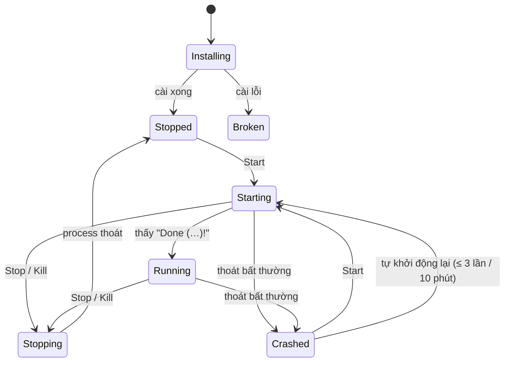

# Spec P1 — Một server chạy được

- Trạng thái: đã làm xong 17 PR; còn chờ lần thử tay 5 phút trên Windows mới cài
  ([kết quả thử tay](p1-ket-qua-thu-tay.md))
- Ngày: 2026-10-23
- Spec gốc: "MineHost v2 — Spec kiến trúc (Rust)", phần Lộ trình P1
- Kế hoạch PR: [p1-ke-hoach-pr.md](p1-ke-hoach-pr.md)

## 1. Mục tiêu

Người chưa từng host server, trên máy Windows chưa cài Java và Docker, tải MineHost về và trong
**dưới 5 phút** có một server Paper chạy được, vào chơi được từ LAN. Không mở terminal, không sửa file tay.

### Tiêu chí hoàn thành

- [ ] Trên máy Windows mới cài, người chưa từng dùng tạo được Paper và vào từ LAN trong dưới 5 phút
      (đo theo checklist ở mục 11).
- [x] Test tích hợp trong CI chạy Paper thật trên Windows và Linux: tạo, chờ `Done`, gửi lệnh, dừng sạch.
- [x] Kill controller giữa chừng thì không còn process Java mồ côi; khởi động lại thì server tự bật lại.
- [x] Bấm "Thoát" khi có 3 server đang chạy: cả 3 dừng bằng `stop`, world mở lại được, không server nào bị kill.

### Không làm trong P1

Vanilla, Purpur và các loại server khác (P2); mod và modpack (P3); backup (P2); nhiều tài khoản và
mật khẩu admin (P2); truy cập từ LAN vào **giao diện** MineHost (P2); Docker (P4); mở server ra
Internet (P4); dùng Java có sẵn trên máy; khởi động cùng Windows (P4); icon khay trên Linux (xem 3.3).

## 2. Luồng người dùng

### 2.1 Lần chạy đầu

1. Người dùng giải nén và bấm đúp `minehost.exe`. Không có cửa sổ console nào hiện ra.
2. Icon MineHost xuất hiện ở khay hệ thống, trình duyệt tự mở `http://127.0.0.1:7878`.
3. Danh sách server đang trống, có một nút lớn "Tạo server đầu tiên".
4. Bấm đúp `minehost.exe` lần nữa thì không chạy bản thứ hai, chỉ mở lại trình duyệt (mục 6.4).

### 2.2 Tạo server (wizard 3 bước)

| Bước | Nội dung | Mặc định |
| --- | --- | --- |
| 1. Loại server | Chỉ có Paper ("Khuyên dùng: nhanh, hỗ trợ plugin"). Vanilla hiện dạng mờ, ghi "sắp có" | Paper |
| 2. Phiên bản | Danh sách bản release mà Paper có build STABLE, mới nhất ở trên cùng. Có công tắc "Hiện bản cũ hơn" | Bản mới nhất |
| 3. Tên và RAM | Tên (1–64 ký tự), thanh trượt RAM có ghi "đề xuất", mục "Nâng cao" thu gọn chứa cổng | Tên "Server của tôi", RAM theo mục 4.3, cổng tự chọn |

Bấm "Tạo" thì một Job chạy và UI hiện tiến độ từng bước:
"Tải Java 21 (48/61 MB)" → "Tải Paper 1.21.4" → "Chuẩn bị file". Tạo xong, người dùng được đưa
tới trang chi tiết của server, nút chính là "Bật server".

### 2.3 Bật server lần đầu và EULA

Lần đầu bấm "Bật server", một hộp thoại hiện ra: "Minecraft yêu cầu bạn đồng ý Điều khoản người dùng
(EULA) của Mojang", kèm link `https://aka.ms/MinecraftEULA` và hai nút "Tôi đồng ý" / "Hủy".
Đồng ý thì controller ghi `eula=true` vào `eula.txt`, lưu thời điểm đồng ý vào `instance.toml`,
rồi bật server. Controller **không bao giờ** tự ghi `eula=true` khi người dùng chưa bấm đồng ý.

### 2.4 Trang chi tiết server

- Đầu trang: tên, trạng thái (Đang tắt / Đang bật… / Đang chạy / Đang tắt… / Bị lỗi), địa chỉ để
  vào chơi từ LAN (`192.168.x.x:25565`, có nút chép), các nút Bật / Tắt / Khởi động lại.
  "Buộc dừng" nằm trong menu "…" và cần xác nhận.
- Tab **Console**: log realtime, ô nhập lệnh (Enter để gửi, mũi tên lên/xuống để xem lại lệnh cũ).
- Tab **Cài đặt game**: các khóa phổ biến của `server.properties` (mục 5.4) và một bảng "Nâng cao"
  để sửa mọi khóa. Sửa khi server đang chạy thì có ghi chú "Có hiệu lực sau khi khởi động lại".
- Tab **Cài đặt server**: tên, RAM, cổng, tự bật khi mở MineHost, tự khởi động lại khi crash, xóa server.

### 2.5 Thoát MineHost

Chọn "Thoát" từ icon khay (hoặc nút trong UI): nếu có server đang chạy thì hỏi "Có N server đang
chạy. Tắt an toàn tất cả rồi thoát?". Đồng ý thì UI hiện tiến độ tắt từng server, xong thì
controller tắt hẳn. Ở khay không có hộp thoại: chữ trên menu đổi thành "Thoát (tắt an toàn N server)"
(ADR 0002). Đóng tab trình duyệt không ảnh hưởng gì.

## 3. Quyết định riêng của P1

### 3.1 Chưa dùng SQLite

P1 không cần chỉ mục hay lịch sử lâu dài: danh sách server lấy bằng cách quét `servers/*/instance.toml`,
còn Job chỉ giữ trong RAM. SQLite được đưa vào ở P2, khi có tài khoản và nhật ký thao tác.
Lý do: nguyên tắc "chưa cần thì chưa làm", và đĩa vẫn là nguồn dữ liệu chính.

### 3.2 Chỉ dùng Java do MineHost quản lý

P1 luôn tải Temurin JRE vào `java/<major>/` và không dò Java có sẵn trên máy. Cách này loại bỏ
một lớp lỗi kiểu "Java sai phiên bản" hay "thiếu quyền trong `Program Files`". Tùy chọn dùng Java
hệ thống để sau.

### 3.3 Icon khay chỉ có trên Windows

Trên Linux, icon khay cần GTK và libappindicator. Người dùng Linux chủ yếu chạy VPS không có màn hình.
Vì vậy ở P1, bản Linux chạy không có giao diện khay, tắt bằng Ctrl+C hoặc `SIGTERM` (vẫn dừng an toàn
mọi server). Icon khay cho Linux desktop xét lại ở P4 cùng Tauri.

### 3.4 Xóa server là chuyển vào thùng rác

Chưa có backup thì không được xóa vĩnh viễn. "Xóa" chuyển thư mục server sang
`<data>/trash/<server-id>-<thời điểm>/`; UI ghi rõ đường dẫn này để người dùng tự lấy lại.

### 3.5 Phiên bản Minecraft là chuỗi không phân tích

Mojang đã chuyển sang đánh số kiểu `26.3`, bên cạnh `1.21.11` và các snapshot như `26.4-snapshot-5`.
`McVersion` chỉ là chuỗi đã kiểm tra hợp lệ. Thứ tự sắp xếp lấy từ `releaseTime` trong manifest của
Mojang, không tự so sánh số.

## 4. Mô hình dữ liệu

### 4.1 `instance.toml` (schema 1)

```toml
schema = 1
id = "01JB8Z6Q0K3V5T2N8XWJ4R7M9C"
name = "Server của tôi"
created_at = "2026-10-23T10:00:00Z"

[game]
loader = "paper"
minecraft = "1.21.4"
build = 232                      # build Paper đang dùng
jar = "server.jar"
java_major = 21                  # lấy từ javaVersion.majorVersion của Mojang

[runtime]
memory_mb = { min = 1024, max = 4096 }
jvm_args = []                    # chỉ sửa được trong chế độ Nâng cao

[network]
port = 25565

[policy]
autostart = false
restart_on_crash = true

[eula]
accepted_at = "2026-10-23T10:05:00Z"   # không có khóa này = chưa đồng ý
```

- Ghi bằng `write_atomic`. Khóa lạ thì giữ nguyên khi ghi lại (đọc vào `toml::Table` phụ) để bản
  mới hơn của MineHost không làm mất dữ liệu.
- `schema` lớn hơn bản hiện tại thì server được đánh dấu `Broken` với lý do "Tạo bởi bản MineHost mới hơn".
- `port` ở đây là nguồn chính; controller ghi đè `server-port` trong `server.properties` trước mỗi lần bật.

### 4.2 Trạng thái server



- Hàm chuyển trạng thái nằm trong `mh-core`, thuần và có test đủ mọi cặp (trạng thái, sự kiện).
- Sự kiện không hợp lệ (ví dụ `start` khi đang `Running`) trả lỗi `SERVER_BUSY`, không làm gì cả.
- `Crashed` kèm 200 dòng log cuối và một `CrashHint` (mục 5.6).

### 4.3 Đề xuất RAM

`suggest_memory_mb(total_mb)` là hàm thuần trong `mh-core`:

- `max` = 1/4 RAM máy, làm tròn xuống bội số 512, kẹp trong khoảng 1024..8192.
- `min` = `min(1024, max)`.
- Thanh trượt cho chọn tới `total - 2048` MB. Vượt quá RAM đang trống thì cảnh báo vàng nhưng vẫn cho chọn.

### 4.4 Cổng

Mặc định 25565. Nếu cổng đó đã có server MineHost khác dùng, hoặc đang bị chương trình khác chiếm
(thử bind `0.0.0.0:<port>`), thì lấy cổng trống tiếp theo, tối đa tới 25600.

### 4.5 Mã lỗi mới trong `ErrorCode`

| Mã | Khi nào | Gợi ý sửa gửi kèm (`fix`) |
| --- | --- | --- |
| `SERVER_BUSY` | Thao tác không hợp lệ với trạng thái hiện tại | — |
| `EULA_NOT_ACCEPTED` | Bật server khi chưa đồng ý EULA | `accept_eula` |
| `PORT_IN_USE` (đã có) | Cổng game bị chiếm khi bật | `change_port` + cổng gợi ý |
| `VERSION_NOT_FOUND` | Phiên bản không có trên Mojang/Paper | — |
| `NETWORK_UNAVAILABLE` | Không gọi được API sau khi đã retry | `retry` |
| `DOWNLOAD_FAILED` | Tải file lỗi giữa chừng | `retry` |
| `CHECKSUM_MISMATCH` | Hash file tải về không khớp | `retry` |
| `JAVA_INSTALL_FAILED` | Giải nén hoặc chạy thử Java thất bại | `retry` |
| `NOT_ENOUGH_DISK` | Ổ đĩa còn dưới 1 GB trước khi tải | — |
| `JOB_CANCELLED` | Người dùng hủy Job | — |
| `SERVER_CRASHED` | Kèm `hint` (mục 5.6) | tùy `hint` |

## 5. Thiết kế từng crate

### 5.1 `mh-core`

- `ServerId` (ULID), `McVersion`, `LoaderKind` (`#[non_exhaustive]`, P1 chỉ có `Paper`),
  `InstanceSpec` (ánh xạ `instance.toml`), `MemoryLimits`, `ServerName`, `GamePort`.
  Mọi kiểu có hàm `parse`/`new` kiểm tra hợp lệ; không tạo được giá trị sai.
- `ServerState`, `ServerEvent`, `fn transition(state, event) -> Result<ServerState, ErrorCode>`.
- `properties`: đọc/ghi `server.properties`, **giữ nguyên thứ tự dòng, comment và dòng trống**,
  xử lý escape `\:` `\=` `\uXXXX` như `java.util.Properties`. Test proptest: đọc rồi ghi lại không đổi gì.
- `suggest_memory_mb`, `CrashHint` và hàm `diagnose(lines) -> Option<CrashHint>`.

### 5.2 `mh-net`

- `HttpClient` bọc `reqwest` (rustls). User-Agent: `MineHost/<version> (+https://github.com/Pharos107/MineHost)`.
  PaperMC yêu cầu User-Agent có thông tin liên hệ.
- Timeout: kết nối 10 giây, đọc 30 giây. Retry 3 lần (0,5 s → 1 s → 2 s) khi timeout, lỗi kết nối, hoặc HTTP 5xx/429.
- `get_json<T>(url, ttl)`: cache trong RAM theo URL. Bản tốt gần nhất được lưu vào `cache/meta/`
  để tạo server được khi mạng chập chờn (dùng bản cũ, có cảnh báo).
- `download(url, Checksum::Sha1|Sha256, dest, progress, cancel)`: tải vào `dest.part`, tính hash
  trong lúc tải, khớp thì `rename`, không khớp thì xóa và báo `CHECKSUM_MISMATCH`.
  Kiểm tra ổ đĩa còn trống trước khi tải. File đã tải lưu trong `cache/<algo>/<2 ký tự đầu>/<hash>`;
  lần sau cùng hash thì chép từ cache, không tải lại.
- Test bằng `wiremock`: retry, timeout, sai hash, hủy giữa chừng, dùng cache.

### 5.3 `mh-providers`

**Mojang** (`https://piston-meta.mojang.com/mc/game/version_manifest_v2.json`):

- `releases()`: các bản `type = "release"` kèm `releaseTime`.
- `version_detail(id)`: tải JSON của từng bản (có `sha1` trong manifest để kiểm tra), lấy
  `javaVersion.majorVersion` và `downloads.server` (url, sha1, size). Bản rất cũ thiếu `javaVersion`
  thì dùng 8. Đã kiểm chứng ngày 2026-10-23: 26.3 cần Java 25, 1.21.x cần 21, 1.16.5 trở về trước cần 8.

**Paper** (Fill API v3, `https://fill.papermc.io/v3/projects/paper`):

- `versions()`: danh sách phiên bản, chỉ giữ bản có trong danh sách release của Mojang (bỏ `-rc`, `-pre`).
- `latest_stable_build(version)`: build mới nhất có `channel = "STABLE"`. Lấy
  `downloads["server:default"]` gồm url, `checksums.sha256` và size.
- Kết quả là `LaunchRecipe { jar: "server.jar", args: ["--nogui"] }`.

Test bằng fixture JSON ghi từ API thật vào `crates/mh-providers/fixtures/`. Test gọi API thật
đánh dấu `#[ignore]`.

### 5.4 `mh-java`

- `ensure(major) -> JavaRuntime { home, java_bin, version }`. Nếu `java/<major>/` đã có và chạy
  `java -version` được thì dùng luôn.
- Nếu chưa có: gọi
  `https://api.adoptium.net/v3/assets/latest/<major>/hotspot?architecture=<x64|aarch64>&image_type=jre&os=<windows|linux>&vendor=eclipse`,
  lấy `binary.package` (link, `checksum` sha256, size). Tải về, giải nén vào `java/.tmp-<major>-<ulid>/`
  qua `SafeRoot` (chặn zip-slip), bỏ thư mục gốc `jdk-21.0.x-jre/`, chạy thử `java -version`,
  rồi `rename` thành `java/<major>/`. Lỗi giữa chừng thì xóa thư mục tạm.
- Hai server cùng cần Java 21 thì chỉ tải một lần (khóa theo `major` bằng `tokio::sync::Mutex`).
- **Lỗi đã biết (2026-11-11):** Minecraft 1.17 và 1.17.1 cần Java 16, nhưng Adoptium không phát hành
  JRE cho Java 16 (chỉ có JDK), nên API trên trả danh sách rỗng và Job tạo server dừng ở
  `JAVA_INSTALL_FAILED`. Chưa sửa; xem [rà soát 2026-11-11](../ra-soat/2026-11-11-kien-truc.md), mục B1.

### 5.5 `mh-runtime` (chỉ `ProcessRuntime`)

Lệnh chạy:

```text
<java_bin> -Xms<min>M -Xmx<max>M
  -Dfile.encoding=UTF-8 -Dstdout.encoding=UTF-8 -Dstderr.encoding=UTF-8
  -Dsun.stdout.encoding=UTF-8 -Dsun.stderr.encoding=UTF-8
  <jvm_args…> -jar server.jar --nogui
```

- Thư mục làm việc là `servers/<id>/server/`. stdin, stdout và stderr đều là pipe; stdout và stderr
  được gộp thành một luồng `ConsoleLine { seq, stream, text }`, giải mã UTF-8 kiểu lossy.
- Các cờ `encoding` là bắt buộc: Java trên Windows ghi ra pipe theo code page của hệ thống, nên
  thiếu chúng là tiếng Việt trong log bị vỡ.
- **Windows:** cờ `CREATE_NO_WINDOW`; gán process vào một Job Object có `JOB_OBJECT_LIMIT_KILL_ON_JOB_CLOSE`.
  Handle của Job Object do controller giữ, nên controller chết thì OS kill Java.
- **Linux:** `prctl(PR_SET_PDEATHSIG, SIGKILL)` trong `pre_exec`. Lưu ý: tín hiệu này gắn với **luồng**
  đã fork chứ không phải process. Vì vậy mọi lần spawn phải đi qua một luồng `std::thread` riêng, sống
  suốt vòng đời controller ("spawner thread"). Không được spawn từ `spawn_blocking`: luồng đó tự thoát
  sau 10 giây rảnh, kéo theo server bị kill.
- Phần `unsafe` (Job Object, `prctl`) nằm trong `crates/mh-runtime/src/os/{windows,linux}.rs`, mỗi
  khối có comment `// SAFETY:`. Ngoài ra chỉ có `minehost/src/win32.rs` mở `unsafe_code` (ADR 0002).
- Test: dùng binary giả `fake-mc` (một `[[bin]]` chỉ có trong test) in ra `Done (0.1s)!`, đọc stdin,
  thoát khi nhận `stop`, và có cờ để giả lập crash hoặc treo. Test không cần Java.

### 5.6 `mh-supervisor`

- Mỗi server một actor (task tokio). Nhận `Command` qua `mpsc`: `Start`, `Stop`, `Restart`, `Kill`,
  `Send(line)`. Phát `ServerEvent`/`ConsoleLine` qua `broadcast`.
- **Trước khi bật:** EULA đã đồng ý; ghi `server-port` vào `server.properties`; cổng còn trống; Java
  đã có (thiếu thì chạy `ensure`).
- **Sẵn sàng:** dòng khớp regex `\]: Done \(` thì chuyển sang `Running`. Sau 5 phút chưa thấy thì vẫn
  giữ `Starting` nhưng phát cảnh báo; không tự kill.
- **Dừng an toàn:** gửi `stop`, chờ tối đa 60 giây, quá hạn thì kill.
- **Crash:** process thoát mà không do người dùng yêu cầu. Nếu `restart_on_crash` thì tự bật lại
  sau 5 s, 15 s, 30 s; quá 3 lần trong 10 phút thì dừng ở `Crashed`.
- **Console:** bộ đệm vòng 5.000 dòng, `seq` tăng dần không bao giờ lặp. Đồng thời ghi
  `servers/<id>/logs/console-YYYY-MM-DD.log`, giữ 14 ngày.
- **Dấu đang chạy:** khi bật, tạo file `servers/<id>/.running`; khi dừng sạch, xóa file đó. Lúc
  controller khởi động, server nào còn file này (tức controller đã chết giữa chừng) hoặc có
  `autostart = true` thì được bật lại. Các server bật song song, sau khi web đã mở. Server còn
  dấu mà gặp cổng bận thì thử lại mỗi 250 ms trong tối đa 10 giây, vì Java của lần chạy trước có
  thể chưa nhả cổng; server chỉ có `autostart` thì không chờ.
- **`diagnose` (`CrashHint`):** đọc các dòng log cuối.

| Dấu hiệu trong log | Hint | Gợi ý cho người dùng |
| --- | --- | --- |
| `java.lang.OutOfMemoryError` | `NOT_ENOUGH_MEMORY` | Tăng RAM cho server |
| `UnsupportedClassVersionError` | `WRONG_JAVA` | Báo lỗi MineHost (không nên xảy ra) |
| `FAILED TO BIND TO PORT` | `PORT_IN_USE` | Đổi cổng |
| `You need to agree to the EULA` | `EULA_NOT_ACCEPTED` | Đồng ý EULA |
| `Exception in server tick loop` | `GAME_ERROR` | Xem log; thử khởi động lại |

### 5.7 `mh-app`

- `JobRunner`: Job chạy trên task tokio, có `CancellationToken`, tiến độ dạng
  `{ step, step_index, step_count, bytes_done?, bytes_total? }`, giữ trong RAM 50 Job gần nhất.
  Tối đa 2 lượt tải chạy cùng lúc.
- `ServerService`: `create`, `list`, `get`, `update_settings`, `accept_eula`, `trash`,
  `start`/`stop`/`restart`/`kill`, `send_command`, `read_properties`/`write_properties`.
- **Job `create`:** kiểm tra ổ đĩa → lấy phiên bản từ Mojang và Paper → `java.ensure` → tải Paper →
  tạo thư mục, `server.properties` mặc định (`motd` = tên server), `instance.toml` → `Stopped`.
  Hủy hoặc lỗi giữa chừng thì xóa thư mục server vừa tạo dở.
- `reconcile()` lúc khởi động; `shutdown_all()` dừng song song mọi server, phát tiến độ.

### 5.8 `mh-api`

REST (mọi thao tác dài trả `202` kèm `job_id`):

| Method | Path | Ghi chú |
| --- | --- | --- |
| GET | `/servers` | Danh sách server kèm trạng thái |
| POST | `/servers` | `{ name, loader, minecraft, memory_mb?, port? }` → `202 { server_id, job_id }` |
| GET / PATCH | `/servers/{id}` | PATCH: `name`, `memory_mb`, `port`, `autostart`, `restart_on_crash` |
| DELETE | `/servers/{id}?confirm_name=` | Chỉ khi đang tắt; chuyển vào thùng rác |
| POST | `/servers/{id}/eula` | `{ "accept": true }` |
| POST | `/servers/{id}/actions/{action}` | `start`, `stop`, `restart`, `kill` |
| POST | `/servers/{id}/console` | `{ "command": "say hi" }` |
| GET | `/servers/{id}/console?after_seq=` | Các dòng trong bộ đệm |
| GET / PUT | `/servers/{id}/properties` | Toàn bộ khóa–giá trị |
| GET | `/catalog/paper/versions` | `[{ id, release_time, java_major }]` |
| GET | `/jobs/{id}` · POST `/jobs/{id}/cancel` | |
| GET | `/system` | Thêm `suggested_memory_mb`, `lan_addresses` |
| POST | `/app/shutdown` | Tắt an toàn mọi server rồi thoát |

WebSocket `/api/v1/ws`:

- Client gửi `{ "subscribe": ["servers", "server.<id>.console", "job.<id>"], "since": { "server.<id>.console": 120 } }`.
- Server gửi `{ "topic": "...", "seq": 121, "data": {...} }`. Kết nối lại với `since` thì nhận tiếp
  từ bộ đệm, không mất dòng.

**Bảo vệ API trên localhost (bắt buộc từ P1):** một trang web bất kỳ người dùng đang mở có thể gửi
request tới `127.0.0.1:7878`. Vì vậy:

- Header `Host` phải là `127.0.0.1:<port>` hoặc `localhost:<port>`, nếu không thì trả 403 (chặn DNS rebinding).
- Request thay đổi dữ liệu (POST/PUT/PATCH/DELETE) và WebSocket: `Origin` phải trùng địa chỉ của
  MineHost; thiếu `Origin` thì phải có header `X-MineHost: 1` (cho CLI và test).
- Body phải là `application/json`; với method thay đổi dữ liệu thì từ chối form-encoded.

### 5.9 Binary `minehost`

- `#![cfg_attr(all(windows, not(debug_assertions)), windows_subsystem = "windows")]`: bản release trên
  Windows không có cửa sổ console. Khi chạy từ terminal, gọi `AttachConsole(ATTACH_PARENT_PROCESS)` để
  các lệnh như `minehost paths` vẫn in ra được.
- **Một bản duy nhất:** khóa `<data>/minehost.lock` (`File::try_lock` của std) và ghi `<data>/runtime.json` `{ url, pid }`.
  Chạy bản thứ hai thì đọc `runtime.json`, mở trình duyệt tới `url` rồi thoát với mã 0.
- **Khay (Windows):** `tray-icon` chạy vòng lặp sự kiện trên luồng chính, tokio chạy trên các luồng
  khác. Menu gồm "Mở MineHost", "Thoát". Tooltip: "MineHost — 2 server đang chạy".
- **Thoát:** từ khay, `/app/shutdown`, Ctrl+C hoặc `SIGTERM` đều đi qua cùng một `shutdown_all()`.

## 6. Giao diện (`ui/`)

- Router: `/` (danh sách), `/new` (wizard), `/servers/:id` (chi tiết, các tab).
- Console dùng `@xterm/xterm` cùng addon fit; giới hạn 5.000 dòng hiển thị.
- Một kết nối WebSocket dùng chung cho cả app; TanStack Query lấy dữ liệu REST, còn sự kiện WebSocket
  thì cập nhật cache của query.
- Mọi chuỗi đều qua i18n (vi, en). Mọi mã lỗi ở mục 4.5 phải có bản dịch; có test kiểm tra
  `vi.json` và `en.json` có đủ khóa như nhau.
- Hộp thoại xác nhận cho: Buộc dừng, Xóa (phải gõ lại tên server), Thoát khi còn server chạy.

## 7. Phụ thuộc mới

| Crate | Thư viện | Lý do |
| --- | --- | --- |
| `mh-core` | `ulid`, `regex` | ID server, nhận dòng `Done` và chẩn đoán crash |
| `mh-net` | `reqwest` (rustls, stream), `sha1`, `sha2`, `tokio-util` | HTTP, kiểm tra hash, hủy |
| `mh-java` | `zip`, `flate2`, `tar` | Giải nén JRE |
| `mh-runtime` | `windows-sys` (Windows), `libc` (Linux) | Job Object, `prctl` |
| `minehost` | `tray-icon` (Windows) | Icon khay; khóa một bản dùng `File::try_lock` của std |
| `ui` | `react-router`, `@xterm/xterm`, `@xterm/addon-fit` | Điều hướng, console |
| `ui` | `lucide-react` | Icon dùng chung cho bộ component |
| `ui` (dev) | `vitest`, `jsdom`, `@testing-library/react`, `@testing-library/user-event` | Test component |

Thêm phụ thuộc thì chạy `cargo deny check` trên máy trước khi mở PR.

## 8. Bảo mật

- Mục 5.8: kiểm tra Host/Origin, header `X-MineHost`, bắt buộc JSON.
- Mọi đường dẫn từ client (P1 chưa có quản lý file, nhưng có `server_id`) đi qua kiểm tra:
  `server_id` phải parse được thành ULID trước khi ghép vào đường dẫn.
- Giải nén JRE qua `SafeRoot`; bỏ qua symlink trong archive.
- Lệnh console gửi nguyên văn tới stdin của server. Đây là tính năng (quyền như op), chỉ người
  ngồi trước máy dùng được, vì P1 chỉ lắng nghe `127.0.0.1`.

## 9. Test

| Lớp | Nội dung chính |
| --- | --- |
| Unit | Kiểu domain, máy trạng thái (mọi cặp), `server.properties` (proptest), đề xuất RAM, `diagnose` |
| Provider/net | wiremock với fixture; retry, sai hash, hủy, cache |
| Runtime/supervisor | `fake-mc`: sẵn sàng, dừng an toàn, quá hạn rồi kill, crash rồi tự khởi động lại, treo |
| API | `oneshot` cho từng route; Host/Origin bị chặn; mã lỗi đúng |
| Tích hợp (CI, chạy tay) | Paper thật, phiên bản cố định 1.21.4, Java 21, trên Windows và Linux: tạo → EULA → bật → `Done` → `list` → tắt → không còn Java |
| Process mồ côi (CI) | Chạy binary `minehost`, bật server, kill -9 controller, trong 5 giây không còn Java; chạy lại thì server tự bật |
| UI | Vitest cho hàm format/i18n; Playwright smoke cho wizard với API thật |

Java và Paper tải trong CI được cache bằng `actions/cache`, khóa theo phiên bản.

## 10. Rủi ro

| Rủi ro | Cách giảm |
| --- | --- |
| Antivirus nghi ngờ binary chưa ký tạo process Java ẩn | Hướng dẫn trong README; tên process rõ ràng; ghi log mọi lần spawn |
| `PR_SET_PDEATHSIG` kill nhầm server khi luồng spawn thoát | Spawner thread riêng (mục 5.5); có test riêng |
| API Fill v3 của Paper thay đổi | Fixture + test gọi API thật chạy tay; lỗi parse trả `NETWORK_UNAVAILABLE` kèm log chi tiết |
| Mạng chậm khiến không đạt 5 phút (JRE ~60 MB, Paper ~50 MB) | Đo riêng thời gian tải; tiêu chí 5 phút đo trên mạng ≥ 20 Mbps |
| Vòng lặp sự kiện khay xung đột với tokio | Khay ở luồng chính, tokio ở luồng khác, giao tiếp qua channel; làm trong một PR riêng |

## 11. Checklist thử tay cho tiêu chí 5 phút

Dùng máy hoặc VM Windows 11 mới cài, chưa có Java, mạng ≥ 20 Mbps:

1. Tải `minehost-vX-x86_64-pc-windows-msvc.zip` từ GitHub Releases, giải nén, bấm đúp. **Bắt đầu bấm giờ.**
2. Tạo server Paper bản mới nhất với giá trị mặc định.
3. Bật server, đồng ý EULA, chờ trạng thái "Đang chạy".
4. Từ một máy khác trong LAN, vào Minecraft bằng địa chỉ hiện trên trang server. **Dừng bấm giờ.**
5. Ghi lại: thời gian, chỗ nào phải đọc lại hoặc đoán, lỗi gặp phải. Đạt khi dưới 5 phút và không cần trợ giúp.
