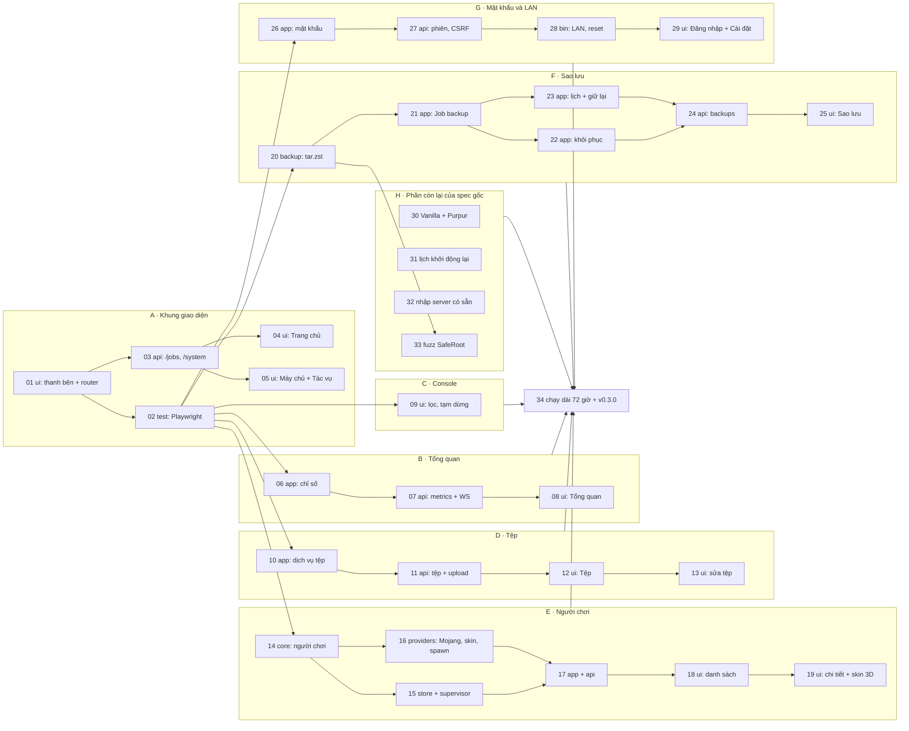

# Kế hoạch PR cho P2

Spec: [p2-nhieu-server-va-van-hanh.md](p2-nhieu-server-va-van-hanh.md). P2 được chia thành 34 PR trong
9 nhóm. Mỗi PR làm một việc, khoảng 400 dòng trở xuống (không tính fixture và code sinh tự động),
có test, CI xanh mới merge.

Thứ tự theo yêu cầu "giao diện trước": làm khung thanh bên trước, rồi lần lượt từng trang kèm backend
của nó. Phần còn lại của spec gốc (nhóm H) làm sau cùng.

## Tiến độ

Cập nhật 2026-11-12, sau khi merge #44–#48. PR nào merge
thì sửa dòng của nó ở đây trong chính PR ấy.

| PR kế hoạch | Việc | Trạng thái | PR GitHub |
| --- | --- | --- | --- |
| 01 | Thanh bên và router | Đã merge | [#27](https://github.com/Pharos107/MineHost/pull/27) |
| 02 | Playwright với binary thật | Đã merge | [#39](https://github.com/Pharos107/MineHost/pull/39) |
| 03 | API Job và thông tin máy | Đã merge | [#32](https://github.com/Pharos107/MineHost/pull/32) |
| 04 | Trang chủ | Đã merge | [#38](https://github.com/Pharos107/MineHost/pull/38) |
| 05 | Trang Máy chủ, trang Tác vụ | Đã merge | [#29](https://github.com/Pharos107/MineHost/pull/29), [#33](https://github.com/Pharos107/MineHost/pull/33) |
| 06, 07 | Chỉ số server, REST và WebSocket | Đã merge (gộp một PR) | [#37](https://github.com/Pharos107/MineHost/pull/37) |
| 08 | Trang Tổng quan | Đã merge | [#31](https://github.com/Pharos107/MineHost/pull/31), [#40](https://github.com/Pharos107/MineHost/pull/40) |
| 09 | Console: lọc, tạm dừng, xóa | Đã merge | [#28](https://github.com/Pharos107/MineHost/pull/28) |
| 10 | Dịch vụ tệp | Đã merge | [#35](https://github.com/Pharos107/MineHost/pull/35) |
| 11 | Route tệp, tải lên, tải xuống | Đã merge | [#42](https://github.com/Pharos107/MineHost/pull/42) |
| 12, 13 | Trang Tệp, sửa tệp | Đã merge (gộp một PR) | [#46](https://github.com/Pharos107/MineHost/pull/46) |
| 14 | Phân tích log và lệnh người chơi | Đã merge | [#30](https://github.com/Pharos107/MineHost/pull/30) |
| 15 | File người chơi, sự kiện người chơi | Đã merge | [#36](https://github.com/Pharos107/MineHost/pull/36) |
| 16 | Hồ sơ Mojang, skin, điểm spawn | Đã merge | [#45](https://github.com/Pharos107/MineHost/pull/45) |
| 17, 18, 19 | API và giao diện người chơi | Chưa bắt đầu | |
| 20 | Nén và giải nén tar.zst | Đã merge | [#34](https://github.com/Pharos107/MineHost/pull/34) |
| 21 | Job sao lưu | Đã merge | [#43](https://github.com/Pharos107/MineHost/pull/43) |
| 22 | Job khôi phục | Đã merge | [#47](https://github.com/Pharos107/MineHost/pull/47) |
| 23, 24, 25 | Lịch sao lưu, route, trang Sao lưu | Chưa bắt đầu | |
| 26 | Mật khẩu admin (kèm ADR 0003) | Đã merge | [#44](https://github.com/Pharos107/MineHost/pull/44) |
| 27 | Phiên đăng nhập và CSRF | Có nhánh `feat/api-auth` ở máy phát triển, chưa mở PR | |
| 28, 29 | Listener LAN, trang Đăng nhập và Cài đặt | Chưa bắt đầu | |
| 30, 31, 32 | Vanilla và Purpur, lịch khởi động lại, nhập server | Chưa bắt đầu | |
| 33 | Fuzz `SafeRoot` và workflow hằng tuần | Một phần: có target `backup_restore` (từ [#34](https://github.com/Pharos107/MineHost/pull/34)); chưa có target `SafeRoot::join` và `fuzz.yml` | |
| 34 | Chạy dài 72 giờ, phát hành `v0.3.0` | Chưa bắt đầu | |

## Thứ tự và phụ thuộc

Sau nhóm A, các nhóm B đến G không đụng file Rust của nhau nên làm song song được. Chỗ dễ đụng nhau
là `ui/src/i18n/{vi,en}.json`, `ui/src/App.tsx` và `crates/mh-core/src/error.rs`: PR nào merge sau thì
rebase và giữ cả hai phần.

## Danh sách PR

### Nhóm A · Khung giao diện

#### PR-01 · `feat(ui)`: thanh bên và router mới

- Phạm vi: `AppShell variant="sidebar"`, `NavItem`, `NavSection`, ngăn kéo trên màn hình hẹp; các route
  ở mục 2 của spec, trang chưa có thì hiện `EmptyState` "Sắp có"; tab Console, Cài đặt game, Cài đặt
  server của P1 chuyển thành route riêng; nút Thoát và đổi ngôn ngữ xuống chân thanh bên.
- Test: Vitest cho `NavItem` đánh dấu mục đang mở; route `/servers/:id` vẫn mở được.
- Xong khi: mọi trang P1 vẫn dùng được, thêm `NavItem` vào trang `#/ui`.

#### PR-02 · `test(ui)`: Playwright với binary thật

- Phạm vi: `@playwright/test`, script khởi chạy `minehost` với thư mục dữ liệu tạm và Java giả
  (`fake-mc`); test đầu tiên: tạo server, bật, thấy "Đang chạy", tắt. Job `e2e` trong `ci.yml` trên Linux.
- Xong khi: mỗi PR giao diện sau đó thêm test Playwright cho trang của mình.

#### PR-03 · `feat(api)`: danh sách Job và thông tin máy

- Phạm vi: `GET /jobs?server_id=`; `/system` thêm `cpu_percent`, `memory_used_bytes`, `disk_free_bytes`;
  chạy `npm run gen:api`.
- Test: `oneshot` cho `/jobs` có và không có `server_id`, thứ tự mới nhất trước.

#### PR-04 · `feat(ui)`: Trang chủ

- Phạm vi: `StatTile`; trang `/` theo mục 6.1 của spec.
- Test: Vitest cho phần tính số liệu từ danh sách server; Playwright: trang chủ đếm đúng server đang chạy.

#### PR-05 · `feat(ui)`: trang Máy chủ và trang Tác vụ

- Phạm vi: `/servers` (tìm, lọc, sắp xếp, nút trên từng dòng) và `/jobs` (bảng, hủy, lọc) theo mục 6.2, 6.3.
- Test: Vitest cho bộ lọc và sắp xếp; Playwright: bật server từ nút trên dòng; hủy Job tạo server.

### Nhóm B · Tổng quan

#### PR-06 · `feat(app)`: lấy mẫu chỉ số server

- Phạm vi: `mh-platform::process_usage`, `dir_size`; task lấy mẫu trong `mh-app` (mục 5.7); vòng đệm 720 mẫu.
- Test: vòng đệm bỏ mẫu cũ đúng; `process_usage` với process của chính test; không lấy mẫu khi server tắt.

#### PR-07 · `feat(api)`: chỉ số qua REST và WebSocket

- Phạm vi: `GET /servers/{id}/metrics?since=`; topic `server.<id>.metrics`.
- Test: `oneshot` với `since`; WebSocket nhận mẫu mới.

#### PR-08 · `feat(ui)`: trang Tổng quan

- Phạm vi: `LineChart` (SVG, có trang `#/ui`), trang theo mục 6.4.
- Test: Vitest cho phần chia trục thời gian; Playwright: server chạy thì có số CPU và RAM.

### Nhóm C · Console

#### PR-09 · `feat(ui)`: lọc, tạm dừng, xóa màn hình console

- Phạm vi: mục 6.5 của spec, chỉ phía trình duyệt.
- Test: Vitest cho bộ lọc dòng; Playwright: lọc theo từ khóa chỉ còn dòng khớp.

### Nhóm D · Tệp

#### PR-10 · `feat(app)`: dịch vụ tệp

- Phạm vi: liệt kê, đọc văn bản kèm `ETag`, ghi có `If-Match`, tạo thư mục, đổi tên, xóa vào thùng rác
  (mục 3.6), chặn `server.jar` khi đang chạy; các mã lỗi `FILE_*`.
- Test: `../` và symlink trỏ ra ngoài bị chặn; ghi với `ETag` cũ trả `FILE_CHANGED`; file nhị phân trả `FILE_NOT_TEXT`.

#### PR-11 · `feat(api)`: route tệp, tải lên, tải xuống

- Phạm vi: các route tệp ở mục 5.8; `multipart` chỉ cho route upload, vẫn qua kiểm tra Origin; tải
  xuống dạng stream.
- Test: upload quá 512 MiB bị `FILE_TOO_LARGE` (giới hạn rút ngắn trong test); upload ở route khác bị từ chối.

#### PR-12 · `feat(ui)`: trang Tệp

- Phạm vi: `Breadcrumb`, `FileDrop`; trang theo mục 6.6 trừ trình sửa.
- Test: Playwright: tạo thư mục, tải file lên, đổi tên, xóa.

#### PR-13 · `feat(ui)`: sửa tệp

- Phạm vi: `TextArea variant="code"`; `/files/edit`, Ctrl+S, cảnh báo rời trang, xử lý `FILE_CHANGED`.
- Test: Playwright: sửa `server.properties`, lưu, mở lại thấy nội dung mới.

### Nhóm E · Người chơi

#### PR-14 · `feat(core)`: phân tích log và lệnh người chơi

- Phạm vi: module `players` và `freeze_attributes` ở mục 5.1 của spec.
- Fixture: log `joined`/`left`/`list` của 1.16.5, 1.20.4, 1.21.4, 26.x.
- Test: mọi fixture; `offline_uuid("Notch")` khớp giá trị Minecraft tính; tin nhắn có `"` và `\` được escape;
  tên sai định dạng bị từ chối.

#### PR-15 · `feat(store)`: file người chơi của Minecraft; sự kiện người chơi trong supervisor

- Phạm vi: đọc ghi các file ở mục 4.4 giữ trường lạ; supervisor phát `Players(...)`, gửi `list` khi sang `Running`.
- Test: đọc rồi ghi lại không mất trường lạ; `fake-mc` in dòng `joined` thì có sự kiện.

#### PR-16 · `feat(providers)`: hồ sơ Mojang, skin, điểm spawn

- Phạm vi: `profile_by_name`, `skin(uuid)` có cache 24 giờ, chỉ cho phép hai domain ở mục 8; đọc
  `SpawnX/Y/Z` từ `level.dat` bằng `fastnbt`.
- Test: wiremock cho hồ sơ và skin; tên không tồn tại trả `PLAYER_NOT_FOUND`; `level.dat` mẫu ra đúng tọa độ.

#### PR-17 · `feat(app,api)`: danh sách và thao tác người chơi

- Phạm vi: `GET /servers/{id}/players`, `POST .../actions`, `GET /players/{uuid}/skin`, topic
  `server.<id>.players`; server tắt thì sửa file, đang chạy thì gửi lệnh (bảng ở mục 6.7).
- Test: whitelist khi tắt ghi đúng UUID theo `online-mode`; đuổi khi tắt trả `SERVER_NOT_RUNNING`;
  đóng băng ghi `frozen.json`.

#### PR-18 · `feat(ui)`: trang Người chơi

- Phạm vi: `Avatar`; hai bảng, ô thêm theo tên, huy hiệu trạng thái.
- Test: Playwright với `fake-mc` in dòng `joined`: người chơi hiện trong bảng Đang online.

#### PR-19 · `feat(ui)`: chi tiết người chơi và skin 3D

- Phạm vi: hộp thoại chi tiết, các nhóm thao tác, nút mờ khi server tắt; `skinview3d` tải lười.
- Test: Vitest cho phần chọn nút theo trạng thái server; kiểm tra chunk `skinview3d` không nằm trong bundle chính.

### Nhóm F · Sao lưu

#### PR-20 · `feat(backup)`: nén và giải nén tar.zst

- Phạm vi: `create`, `restore` ở mục 5.6 của spec; target fuzz cho bộ giải nén.
- Test: nén rồi giải nén ra đúng nội dung; archive có `../`, symlink, hardlink bị chặn; sai hash trả
  `BACKUP_CORRUPT`; hủy giữa chừng không để lại `.part`.

#### PR-21 · `feat(app)`: Job sao lưu

- Phạm vi: `send_and_wait` trong supervisor; Job `backup` có `save-off`/`save-all`/`save-on`; file mô tả;
  dọn backup dở lúc khởi động; kiểm tra ổ đĩa.
- Test (`fake-mc`): thứ tự lệnh đúng; `save-on` vẫn gửi khi nén lỗi; server tắt thì không gửi lệnh nào.

#### PR-22 · `feat(app)`: Job khôi phục

- Phạm vi: các bước khôi phục ở mục 5.7, tạo `before_restore`, tắt server nếu đang chạy.
- Test: lỗi giải nén giữa chừng thì `server/` còn nguyên; sau khôi phục nội dung khớp bản backup.

#### PR-23 · `feat(app)`: lịch sao lưu và giữ lại

- Phạm vi: `BackupSchedule`, `next_run` trong `mh-core`; task kiểm tra mỗi phút; xóa bản tự động cũ,
  bỏ qua `manual` và `protected`.
- Test: bảng `next_run` cho cả hai kiểu lịch và lúc đổi ngày; giữ lại đúng N bản; server không chạy thì bỏ qua.

#### PR-24 · `feat(api)`: route sao lưu

- Phạm vi: các route `backups` ở mục 5.8; `PATCH /servers/{id}` nhận `backup`.
- Test: xóa bản được bảo vệ trả `BACKUP_PROTECTED`; khôi phục thiếu `confirm` bị từ chối.

#### PR-25 · `feat(ui)`: trang Sao lưu

- Phạm vi: mục 6.8 của spec.
- Test: Playwright: sao lưu, khôi phục có xác nhận, bảo vệ rồi thử xóa. Thêm vào job `integration`:
  Paper thật, đặt khối, backup, phá, khôi phục, khối còn đó (tiêu chí mục 1).

### Nhóm G · Mật khẩu và LAN

#### PR-26 · `feat(app)`: mật khẩu admin

- Phạm vi: `auth.toml` (mục 4.3), băm `argon2id`, đọc lại khi file đổi; ADR 0003 (mục 3.3 của spec).
- Test: đặt, kiểm tra, đổi, xóa mật khẩu; `lan = true` thiếu mật khẩu thì coi như tắt; quyền `600` trên Linux.

#### PR-27 · `feat(api)`: phiên đăng nhập và CSRF

- Phạm vi: route `/auth/*`, middleware phiên, `X-CSRF-Token`, giới hạn đăng nhập sai theo IP, WebSocket cần phiên.
- Test: chưa đăng nhập bị `AUTH_REQUIRED` cả từ `127.0.0.1`; sai CSRF bị 403; lần sai thứ 6 bị
  `AUTH_RATE_LIMITED` kèm `retry_after_s`; chưa đặt mật khẩu thì như P1.

#### PR-28 · `feat(bin)`: listener LAN và đặt lại mật khẩu

- Phạm vi: mở và đóng listener theo `lan`, quét lại địa chỉ mỗi 60 giây, kiểm tra `Host` theo listener
  đang mở; `/settings/access`; `minehost reset-password`; mục khay "Đặt lại mật khẩu" bấm hai lần.
- Test: bật LAN thì gọi được từ địa chỉ LAN của máy CI, tắt thì không; `reset-password` khi controller
  đang chạy thì lần đăng nhập sau không cần mật khẩu.

#### PR-29 · `feat(ui)`: trang Đăng nhập và Cài đặt

- Phạm vi: mục 6.10 của spec; nút Đăng xuất ở chân thanh bên.
- Test: Playwright: đặt mật khẩu, bị đưa về `/login`, đăng nhập, quay lại trang cũ; bật LAN hiện địa chỉ.

### Nhóm H · Phần còn lại của spec gốc

#### PR-30 · `feat(providers,ui)`: Vanilla và Purpur

- Phạm vi: provider Vanilla và Purpur, `Checksum::Md5`, `/catalog/{vanilla|purpur}/versions`, wizard bật
  hai lựa chọn này.
- Test: fixture API Purpur; md5 sai trả `CHECKSUM_MISMATCH`; tích hợp tạo Vanilla 1.21.4 tới `Done`.

#### PR-31 · `feat(app,ui)`: lịch khởi động lại

- Phạm vi: `policy.restart_at`, báo trước bằng `say`, ô chọn giờ trong Cài đặt server.
- Test (`fake-mc`): tới giờ thì có ba lần `say` rồi khởi động lại; server tắt thì bỏ qua.

#### PR-32 · `feat(app,ui)`: nhập server có sẵn

- Phạm vi: mục 6.11 của spec; Job `import` chép thư mục, nhận loại và phiên bản.
- Test: thư mục mẫu có `version_history.json` của Paper ra đúng phiên bản; có `mods/` thì bị từ chối.

#### PR-33 · `test`: fuzz `SafeRoot` và workflow hằng tuần

- Phạm vi: `fuzz/` với hai target (`SafeRoot::join`, giải nén backup); workflow `fuzz.yml` chạy hằng
  tuần mỗi target 15 phút.
- Xong khi: tiêu chí fuzz ở mục 1 của spec đạt.

### Nhóm I · Kết thúc

#### PR-34 · `docs`: chạy dài 72 giờ và phát hành v0.3.0

- Phạm vi: script chạy 10 server và ghi RSS controller mỗi 10 phút; kết quả trong
  `docs/specs/p2-ket-qua-chay-dai.md`; README thêm sao lưu, LAN, đặt lại mật khẩu; cập nhật
  `AGENTS.md` sang P3; tag `v0.3.0`.
- Xong khi: mọi ô ở mục "Tiêu chí hoàn thành" của spec P2 đã được tích.

## Cách giao PR cho AI agent

- Mỗi lần giao đúng **một** PR, kèm đường dẫn spec P2 và mục liên quan.
- Yêu cầu agent đọc `AGENTS.md` trước, chạy đủ các lệnh kiểm tra trong đó trước khi báo xong.
- PR giao diện phải có test Playwright cho trang của mình (từ PR-02).
- PR vượt khoảng 400 dòng thì tách tiếp, không gộp.
