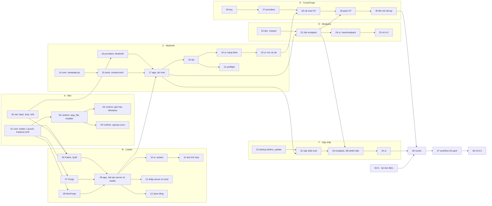

# Kế hoạch PR cho P3

Spec: [p3-mod-va-modpack.md](p3-mod-va-modpack.md). P3 chia thành 38 PR trong 8 nhóm. Mỗi PR làm một
việc, khoảng 400 dòng trở xuống (không tính fixture và code sinh tự động), có test, CI xanh mới merge.

Hai bản phát hành (spec mục 11): nhóm A–D ra `v0.4.0` (PR-25), nhóm E–H ra `v0.5.0` (PR-38).

## Tiến độ

Cập nhật 2026-11-14, sau khi merge #80. PR nào merge thì sửa dòng của nó ở đây trong
chính PR ấy.

| PR kế hoạch | Việc | Trạng thái | PR GitHub |
| --- | --- | --- | --- |
| 01 | Loader mới, cách chạy, bảng mới trong `instance.toml` | Đã merge | [#65](https://github.com/Pharos107/MineHost/pull/65) |
| 02 | Chạy kiểu `args_file` và chạy installer | Đã merge | [#66](https://github.com/Pharos107/MineHost/pull/66) |
| 03 | Giới hạn RAM và số process trên Windows | Đã merge | [#68](https://github.com/Pharos107/MineHost/pull/68) |
| 04 | cgroup v2 trên Linux | Đã merge | [#70](https://github.com/Pharos107/MineHost/pull/70) |
| 05 | SHA-512, danh sách host, 429 | Đã merge | [#67](https://github.com/Pharos107/MineHost/pull/67) |
| 06 | Fabric và Quilt | Đã merge | [#69](https://github.com/Pharos107/MineHost/pull/69) |
| 07 | Forge | Đã merge | [#71](https://github.com/Pharos107/MineHost/pull/71) |
| 08 | NeoForge | Đã merge | [#72](https://github.com/Pharos107/MineHost/pull/72) |
| 09 | Job tạo server có loader | Đã merge | [#73](https://github.com/Pharos107/MineHost/pull/73) |
| 10 | Wizard chọn kiểu server và loader | Đã merge | [#74](https://github.com/Pharos107/MineHost/pull/74) |
| 11 | Tích hợp mỗi loader trên Windows và Linux | Đã merge | [#75](https://github.com/Pharos107/MineHost/pull/75) |
| 12 | Nhập server có sẵn có mod | Đã merge | [#76](https://github.com/Pharos107/MineHost/pull/76) |
| 13 | Chọn Java cho từng server | Đã merge | [#77](https://github.com/Pharos107/MineHost/pull/77) |
| 14 | Đọc metadata mod và plugin | Đã merge | [#79](https://github.com/Pharos107/MineHost/pull/79), [#80](https://github.com/Pharos107/MineHost/pull/80) |
| 15 | `content.toml` và quét thư mục mod | Chưa bắt đầu | |
| 16 | Modrinth | Chưa bắt đầu | |
| 17 | Cài, bật, tắt, gỡ mod | Chưa bắt đầu | |
| 18 | Route mod và tìm kiếm | Chưa bắt đầu | |
| 19 | Trang Mod hoặc Plugin | Chưa bắt đầu | |
| 20 | Tìm và cài mod | Chưa bắt đầu | |
| 21 | Kiểm tra trước khi bật | Chưa bắt đầu | |
| 22–25 | Nhóm D · Modpack Modrinth, `v0.4.0` | Chưa bắt đầu | |
| 26–30 | Nhóm E · CurseForge | Chưa bắt đầu | |
| 31–34 | Nhóm F · Cập nhật và đổi phiên bản | Chưa bắt đầu | |
| 35 | Nhóm G · Bộ nhớ đệm và trạng thái giới hạn | Chưa bắt đầu | |
| 36–38 | Nhóm H · Kiểm thử modpack, `v0.5.0` | Chưa bắt đầu | |

Khi bắt đầu một nhóm thì tách dòng của nhóm thành từng PR.

## Thứ tự và phụ thuộc

A05 và C14 không phụ thuộc gì nên làm song song với A01–A04. Sau B09, nhóm C và các PR B10–B13 làm
song song được. Chỗ dễ đụng nhau vẫn là `ui/src/i18n/{vi,en}.json`, `ui/src/App.tsx`,
`crates/mh-core/src/error.rs` và `AppDeps` trong file test (`git grep -n "AppDeps {" -- crates`).

## Danh sách PR

### Nhóm A · Nền

#### PR-01 · `feat(core)`: loader mới, cách chạy, bảng mới trong `instance.toml`

- Phạm vi: `LoaderKind` thêm bốn loader; `Launch`; `game.loader_version`, `[game.launch]`,
  `[modpack]` (spec mục 4.1); `content_kind`; mã lỗi mục 4.4 kèm bản dịch; ADR 0006 (provider trả kế
  hoạch, spec mục 3.1). `launch_args` trả đúng tham số cho loader mới.
- Test: đọc ghi `instance.toml` có và không có bảng mới, giữ khóa lạ; file P2 đọc ra `Launch::Jar`.

#### PR-02 · `feat(runtime)`: chạy kiểu `args_file` và chạy installer

- Phạm vi: `JavaLaunch` nhận `Launch`, thay `{os}`; `run_to_completion(spec, timeout, on_line)`;
  `fake-mc` thêm chế độ installer (ghi file, thoát với mã chọn trước).
- Test: thứ tự tham số với `@file`; installer quá giờ bị kill; mã thoát và log được trả về.

#### PR-03 · `feat(runtime)`: giới hạn RAM và số process trên Windows

- Phạm vi: `JobMemoryLimit`, `ActiveProcessLimit` (spec mục 3.8); đọc thông báo vượt giới hạn qua
  completion port; `CrashInfo` lý do `memory_limit`, không tự bật lại; bản dịch.
- Test (Windows): `fake-mc --alloc <MB>` vượt giới hạn bị dừng với lý do `memory_limit`.

#### PR-04 · `feat(runtime)`: cgroup v2 trên Linux

- Phạm vi: dò cgroup v2 trong `mh-runtime`; cgroup con mỗi server với `memory.max`,
  `memory.swap.max`, `pids.max`; ghi `cgroup.procs` trong `pre_exec`; đọc `memory.events`; cảnh báo
  một lần khi không ghi được; `ProcessRuntime::limits_enforced()`. Đưa ra API (`GET /system`) ở PR-35.
- Test: chạy dưới `systemd-run --user --scope` trong CI Linux; máy không có cgroup ghi được thì bỏ qua
  có ghi lý do.

#### PR-05 · `feat(net)`: SHA-1, SHA-512, danh sách host, 429

- Phạm vi: spec mục 5.3. Danh sách host theo nguồn ở spec mục 3.7.
- Test: wiremock chuyển hướng sang host lạ bị chặn; 429 có `Retry-After` thành `UPSTREAM_RATE_LIMITED`.

### Nhóm B · Loader

#### PR-06 · `feat(providers)`: Fabric và Quilt

- Phạm vi: phiên bản game và loader từ meta; `plan()` trả installer, tham số, `Launch::Jar`.
- Test: fixture meta thật; bản loader stable đứng đầu; phiên bản không có thì `VERSION_NOT_FOUND`.

#### PR-07 · `feat(providers)`: Forge

- Phạm vi: `promotions_slim.json`, `maven-metadata.xml`; dưới 1.17 `Launch::Jar` theo tên jar installer
  tạo ra, từ 1.17 `Launch::ArgsFile`; từ chối dưới 1.12.2.
- Test: fixture cho 1.12.2, 1.16.5, 1.20.1, 1.21.x; `recommended` trước `latest`.

#### PR-08 · `feat(providers)`: NeoForge

- Phạm vi: `maven-metadata.xml`, ánh xạ phiên bản cả kiểu cũ (`21.4.140`) và kiểu mới (`26.1.2.76`),
  bỏ bản `-beta` trừ khi không còn bản nào khác.
- Test: fixture metadata thật; ánh xạ hai chiều.

#### PR-09 · `feat(app)`: Job tạo server có loader

- Phạm vi: `ServerCatalog` cho bốn loader; Job tải Java, installer, chạy installer, đọc `args_file` thật
  trên đĩa; `GET /catalog/{loader}/{minecraft}/loader-versions`; `POST /servers` nhận `loader_version`;
  chế độ e2e có installer giả; `npm run gen:api`.
- Test: app với `fake-mc` installer thành công và thất bại (`LOADER_INSTALL_FAILED`, thư mục server bị dọn).

#### PR-10 · `feat(ui)`: wizard chọn kiểu server và loader

- Phạm vi: spec mục 6.1; thẻ server hiện loader.
- Test: Vitest cho form; Playwright tạo server Fabric với catalog giả, bật tới "Đang chạy".

#### PR-11 · `test`: tích hợp mỗi loader trên Windows và Linux

- Phạm vi: `crates/minehost/tests/loaders.rs` (ignored), thêm vào job `integration`.
- Xong khi: bốn loader tới `Done` và tắt sạch trên cả hai OS.

#### PR-12 · `feat(app)`: nhập server có sẵn có mod

- Phạm vi: nhận bốn loader khi nhập (spec mục 5.7), đọc `loader_version` từ thư mục `libraries/` hoặc
  file launcher; báo `user_jvm_args.txt` bị bỏ qua.
- Test: fixture thư mục cho từng loader.

#### PR-13 · `feat`: chọn Java cho từng server

- Phạm vi: `PATCH /servers/{id}` nhận `java_major`; Job tải Java khi bật nếu chưa có; mục chọn Java
  trong Cài đặt server (Nâng cao) kèm cảnh báo (spec mục 3.10).
- Test: API từ chối major không có ở Adoptium; Playwright đổi Java.

### Nhóm C · Modrinth và trang Mod

#### PR-14 · `feat(core)`: đọc metadata mod và plugin

- Phạm vi: parser ở spec mục 5.1, luật chỉ chạy client (spec mục 3.5), ràng buộc phiên bản đơn giản.
- Test: fixture metadata trích từ 20 mod và 5 plugin phổ biến.

#### PR-15 · `feat(store)`: `content.toml` và quét thư mục mod

- Phạm vi: spec mục 4.2 và 5.6, cache theo `(path, mtime, size)`.
- Test: file đổi tên, xóa tay, chuyển giữa `mods/` và `mods-disabled/`; giữ khóa lạ.

#### PR-16 · `feat(providers)`: Modrinth

- Phạm vi: spec mục 5.4; User-Agent; cache.
- Test: fixture search, project, version, `version_files` theo hash.

#### PR-17 · `feat(app)`: cài, bật, tắt, gỡ mod

- Phạm vi: Job cài mod kèm dependency, cache theo hash (spec mục 3.4), thay bản cũ khi trùng; bật/tắt;
  gỡ vào thùng rác; tải lên jar; chặn khi server đang chạy.
- Test: dependency hai tầng; dependency vòng; mod không hợp loader thì `CONTENT_INCOMPATIBLE`.

#### PR-18 · `feat(api)`: route mod và tìm kiếm

- Phạm vi: các route `/content/*` và `/servers/{id}/content*` ở spec mục 5.8; nguồn Modrinth giả cho
  chế độ e2e; `npm run gen:api`.
- Test: `oneshot` mỗi route.

#### PR-19 · `feat(ui)`: trang Mod hoặc Plugin

- Phạm vi: spec mục 6.3 trừ hộp thoại tìm kiếm; mục trên thanh bên theo `content_kind`.
- Test: Playwright bật, tắt, gỡ, tải lên jar.

#### PR-20 · `feat(ui)`: tìm và cài mod

- Phạm vi: `ProjectCard`, hộp thoại tìm kiếm có lọc sẵn, xác nhận danh sách dependency.
- Test: Playwright cài một mod có dependency từ nguồn giả.

#### PR-21 · `feat`: kiểm tra trước khi bật

- Phạm vi: `preflight` (spec mục 5.7), `GET /servers/{id}/preflight`, `start` nhận `ignore_preflight`,
  băng cảnh báo đầu trang server.
- Test: thiếu dependency thì `start` trả `DEPENDENCY_MISSING`; Playwright bấm "Vẫn bật".

### Nhóm D · Modpack Modrinth

#### PR-22 · `feat(providers)`: đọc `.mrpack`

- Phạm vi: `MrpackIndex`, giải nén overrides qua `SafeRoot`, giới hạn 8 GiB và 20.000 file, bỏ file
  `env.server = "unsupported"`.
- Test: pack có `../`, đường dẫn tuyệt đối, symlink, URL ngoài danh sách host; zip bomb.

#### PR-23 · `feat(app)`: Job cài modpack

- Phạm vi: `POST /servers/modpack`, `POST /servers/modpack/upload`; tải song song 6 file; RAM đề xuất;
  tóm tắt kết quả; chạy lại Job dùng file đã có trong cache.
- Test: app với pack giả 50 file, một file sai hash thì Job lỗi và dọn thư mục.

#### PR-24 · `feat(ui)`: tạo server từ modpack

- Phạm vi: spec mục 6.2.
- Test: Playwright cài pack từ nguồn giả và từ file `.mrpack` kéo thả.

#### PR-25 · `docs`: phát hành `v0.4.0`

- Phạm vi: README thêm mod và modpack; `AGENTS.md`, mục lục tài liệu; tag `v0.4.0` (hỏi chủ dự án
  trước khi tạo tag).

### Nhóm E · CurseForge

#### PR-26 · `feat`: key CurseForge

- Phạm vi: `option_env!` trong binary, `secrets.toml`, `/settings/curseforge`, mục CurseForge trong Cài
  đặt; workflow `release.yml` truyền secret.
- Test: key không xuất hiện trong mọi response và log; không có key thì `available: false`.

#### PR-27 · `feat(providers)`: CurseForge

- Phạm vi: spec mục 5.4; nhận ra file không tải được qua API.
- Test: fixture search, mod, files; key sai thì `CURSEFORGE_UNAVAILABLE`.

#### PR-28 · `feat`: cài mod từ CurseForge

- Phạm vi: nguồn CurseForge trong luồng cài mod (PR-17) và hộp thoại tìm kiếm (PR-20).
- Test: dependency `relationType = 3`; Playwright tìm và cài từ nguồn CurseForge giả.

#### PR-29 · `feat`: modpack CurseForge

- Phạm vi: `CfManifest`, ưu tiên server pack, dựng từ manifest khi không có; ghi `[[pending]]`.
- Test: pack giả có một mod cấm phân phối; server pack có thư mục gốc lồng một tầng.

#### PR-30 · `feat`: tải tay file CurseForge

- Phạm vi: spec mục 6.4; upload khớp SHA-1 xóa dòng chờ; `CURSEFORGE_FILES_PENDING` chặn `start`.
- Test: Playwright đi hết luồng; file sai hash bị từ chối. Xong khi: tiêu chí 2 của spec đạt với nguồn giả.

### Nhóm F · Cập nhật và đổi phiên bản

#### PR-31 · `feat(backup)`: bản `before_update`, chép `content.toml`

- Test: bản `before_update` được bảo vệ, không tính vào `keep`; khôi phục trả lại `content.toml`.

#### PR-32 · `feat(app)`: kiểm tra và cập nhật mod

- Phạm vi: `POST /servers/{id}/updates/check`, `POST /servers/{id}/updates` với `items`.
- Test: mod "thêm tay" nhận ra qua hash; cập nhật lỗi giữa chừng còn bản backup.

#### PR-33 · `feat(app)`: cập nhật modpack, đổi phiên bản

- Phạm vi: cập nhật modpack (xóa file của bản cũ có `from_modpack`, giữ mod người dùng thêm); đổi bản
  loader hoặc Minecraft; cập nhật build Paper, Purpur.
- Test: mod người dùng tự thêm vẫn còn sau khi cập nhật pack; hạ phiên bản cần `confirm`.

#### PR-34 · `feat(ui)`: giao diện cập nhật và mục Phiên bản

- Phạm vi: nút "Kiểm tra cập nhật" trên trang Mod; mục Phiên bản trong Cài đặt server (spec mục 6.5).
- Test: Playwright cập nhật một mod và đổi phiên bản với nguồn giả. Xong khi: tiêu chí 4 của spec đạt.

### Nhóm G · Bộ nhớ đệm và trạng thái giới hạn

#### PR-35 · `feat`: bộ nhớ đệm tải về, trạng thái giới hạn tài nguyên

- Phạm vi: dung lượng và nút xóa cache file theo hash; `GET /system` thêm `resource_limits`
  (từ `ProcessRuntime::limits_enforced()`) và hiện trong Cài đặt.
- Test: xóa cache khi đang có Job tải thì trả `SERVER_BUSY`.

### Nhóm H · Kiểm thử modpack và phát hành

#### PR-36 · `docs(ops)`: runner tự host cho modpack

- Phạm vi: `docs/ops/runner-modpack.md`: user riêng, unit systemd có giới hạn (spec mục 3.11), cách gỡ.
  Cài runner trên máy thử nghiệm sau khi chủ dự án đồng ý.

#### PR-37 · `test`: workflow 20 modpack

- Phạm vi: `tests/modpacks.toml` (spec mục 9.2), test `modpacks.rs` (ignored), `.github/workflows/modpacks.yml`
  chạy 04:00 giờ Việt Nam trên runner tự host, artifact ghi thời gian và RSS.
- Xong khi: hai đêm liền xanh cả 20 pack.

#### PR-38 · `docs`: phát hành `v0.5.0`

- Phạm vi: chỉnh công thức RAM theo số đo của PR-37; README; `AGENTS.md` sang P4; tag `v0.5.0` (hỏi
  trước). Xong khi: mọi ô ở mục "Tiêu chí hoàn thành" của spec P3 đã được tích.

## Cách giao PR cho AI agent

Như P2: mỗi lần một PR, kèm đường dẫn spec và mục liên quan; agent đọc `AGENTS.md` trước và chạy đủ
lệnh kiểm tra; PR giao diện có test Playwright; PR vượt khoảng 400 dòng thì tách tiếp.
