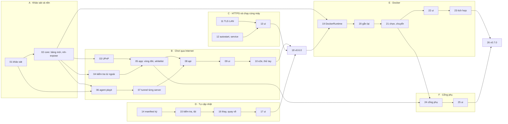

# Kế hoạch PR cho P4

Spec: [p4-truy-cap-internet.md](p4-truy-cap-internet.md). P4 chia thành 26 PR trong 6 nhóm. Mỗi PR làm
một việc, khoảng 400 dòng trở xuống (không tính fixture và code sinh tự động), có test, CI xanh mới
merge.

- Trạng thái: spec và kế hoạch đã merge ở #174. Câu hỏi ở spec mục 12 chưa chốt; chốt trước PR cần đến.
- Hai bản phát hành đề xuất (spec mục 11): `v0.6.0` ở PR-18, `v0.7.0` ở PR-26.

## Tiến độ

PR nào merge thì sửa dòng của nó ở đây trong chính PR ấy.

| PR kế hoạch | Việc | Trạng thái | PR GitHub |
| --- | --- | --- | --- |
| 00 | Spec P4 và kế hoạch này | Xong | #174 |
| 01 | Khảo sát playit, dịch vụ kiểm tra, Docker Desktop | Chờ duyệt | |
| 02 | Bảng `[network]`, `[runtime]`, mã lỗi, crate `mh-expose` rỗng | Chưa làm | |
| 03 | UPnP | Chưa làm | |
| 04 | Kiểm tra từ ngoài, nhận CGNAT | Chưa làm | |
| 05 | Mở/đóng Internet theo vòng đời server, chặn whitelist | Chưa làm | |
| 06 | Agent playit: tải, chạy, liên kết | Chưa làm | |
| 07 | Tunnel playit cho từng server | Chưa làm | |
| 08 | Route mạng | Chưa làm | |
| 09 | Giao diện Chơi qua Internet, thẻ Địa chỉ, playit | Chưa làm | |
| 10 | E2E mạng, thử tay với người chơi ở mạng khác | Chưa làm | |
| 11 | HTTPS cho listener LAN | Chưa làm | |
| 12 | Khởi động cùng Windows, `minehost service` | Chưa làm | |
| 13 | Giao diện LAN HTTPS và Khởi động cùng máy | Chưa làm | |
| 14 | `latest.json` có chữ ký trong Release | Chưa làm | |
| 15 | Kiểm tra và tải bản mới | Chưa làm | |
| 16 | Thay binary, `self-test`, quay về | Chưa làm | |
| 17 | Giao diện cập nhật | Chưa làm | |
| 18 | Phát hành `v0.6.0` | Chưa làm | |
| 19 | `DockerRuntime` | Chưa làm | |
| 20 | Gắn lại container sau khi controller crash | Chưa làm | |
| 21 | Chọn và chuyển cách chạy, kéo image | Chưa làm | |
| 22 | Giao diện Cách chạy, Docker trong Cài đặt chung | Chưa làm | |
| 23 | Tích hợp Process ↔ Docker | Chưa làm | |
| 24 | Cổng phụ | Chưa làm | |
| 25 | Giao diện cổng phụ | Chưa làm | |
| 26 | Phát hành `v0.7.0`, đóng P4 | Chưa làm | |

## Thứ tự và phụ thuộc

Nhóm C và PR-14 không phụ thuộc nhóm B nên làm song song được. Chỗ dễ đụng nhau: `ui/src/i18n/{vi,en}.json`,
`crates/mh-core/src/error.rs`, `crates/mh-core/src/instance*`, `AppDeps` trong file test
(`git grep -n "AppDeps {" -- crates`), `crates/minehost/src/serve.rs`.

## Danh sách PR

### Nhóm A · Khảo sát và nền

#### PR-01 · `docs`: khảo sát playit, dịch vụ kiểm tra, Docker Desktop

- Phạm vi: trả lời năm câu ở spec mục 3.4 trên bản agent playit mới nhất; chọn dịch vụ kiểm tra từ
  ngoài theo tiêu chí mục 3.5; đo Docker Desktop trên Windows (tạo world, `save-all` với Paper) so
  với cách thường. Ghi vào `docs/specs/p4-khao-sat.md` kèm lệnh đã chạy và ngày. Sửa spec mục 3.4,
  5.2 theo kết quả. Code thử (nếu có) không merge.
- Xong khi: chủ dự án duyệt phần sửa của mục 3.4 và 5.2.

#### PR-02 · `feat(core)`: bảng `[network]`, `[runtime]`, mã lỗi, crate `mh-expose`

- Phạm vi: kiểu `NetworkConfig`, `ExtraPort`, `RuntimeKind` trong `mh-core`, đọc ghi trong `mh-store`
  (spec mục 4.1); mã lỗi mục 4.3 kèm bản dịch; crate `mh-expose` rỗng; sửa bảng crate trong
  AGENTS.md và [tong-quan.md](../architecture/tong-quan.md).
- Test: đọc ghi có và không có bảng mới, giữ khóa lạ; file P3 đọc ra `internet = off`, `process`.

### Nhóm B · Chơi qua Internet

#### PR-03 · `feat(expose)`: UPnP

- Phạm vi: tìm IGD, ánh xạ, gia hạn, gỡ, dọn ánh xạ cũ (spec mục 5.1).
- Test: IGD giả (SSDP và SOAP trên `127.0.0.1`), lease 0, cổng đã bị máy khác dùng.

#### PR-04 · `feat(expose)`: kiểm tra từ ngoài, nhận CGNAT

- Phạm vi: `ExternalCheck` gọi `mcstatus.io` (chọn ở PR-01), giới hạn 30 giây; nhận CGNAT (spec mục 3.2).
- Test: wiremock với fixture ghi từ dịch vụ thật; bảng địa chỉ riêng và `100.64/10`.

#### PR-05 · `feat(app)`: mở/đóng Internet theo vòng đời server

- Phạm vi: nghe sự kiện trạng thái, mở khi `Running`, đóng khi tắt hoặc crash; chặn theo bảng mục 3.6,
  đóng ngay khi whitelist bị tắt; trạng thái `internet` trong topic `servers`; gợi ý cách mở lần đầu.
- Test: `fake-mc` với IGD giả; ba dòng của bảng mục 3.6; crash thì ánh xạ bị gỡ.

#### PR-06 · `feat(app)`: agent playit

- Phạm vi: tải bản ghim hash, chạy qua `mh-runtime`, supervisor bật lại có giới hạn, luồng liên kết,
  secret trong `secrets.toml` (spec mục 3.4, 5.2). Binary `fake-playit` cho test.
- Test: liên kết giả; agent chết lặp thì `failed`; secret không xuất hiện trong log và response.

#### PR-07 · `feat(app)`: tunnel playit cho từng server

- Phạm vi: `PlayitTunnels` (spec mục 3.4, 5.2): tìm tunnel theo `local_port`, tạo khi cờ
  `PLAYIT_AUTO_CREATE` bật, xóa và tạo lại khi đổi cổng; ghi `playit_tunnel`, `playit_created`,
  `playit_address`.
- Test: với `fake-playit`; cờ tắt thì không gọi `create`; lỗi `RequiresPlayitPremium` thành
  `PLAYIT_TUNNEL_REJECTED`; không xóa tunnel người dùng tự tạo.

#### PR-08 · `feat(api)`: route mạng

- Phạm vi: route mạng và playit ở spec mục 5.4, topic `system`; `npm run gen:api`.
- Test: `oneshot` từng route; `INTERNET_REQUIRES_WHITELIST` có `params` đủ cho nút sửa.

#### PR-09 · `feat(ui)`: Chơi qua Internet, thẻ Địa chỉ, playit

- Phạm vi: spec mục 6 phần mạng; mục "Server offline-mode an toàn" trong README (spec mục 3.6); gửi
  bản phác cho chủ dự án trước khi code.
- Test: Vitest cho ba trạng thái của thẻ Địa chỉ và nút bật whitelist.

#### PR-10 · `test`: E2E mạng, thử tay

- Phạm vi: Playwright với IGD giả, `fake-playit` và dịch vụ kiểm tra giả ở chế độ e2e; thử tay tiêu
  chí 1 và 2 trên mạng thật, ghi `docs/specs/p4-ket-qua-thu-tay.md`.

### Nhóm C · HTTPS và chạy cùng máy

#### PR-11 · `feat(bin)`: HTTPS cho listener LAN

- Phạm vi: chứng chỉ `rcgen`, nhận TLS và HTTP trên cùng cổng, `308`, cookie `Secure` cho phiên qua
  LAN, dấu vân tay qua `GET /system/lan` chỉ từ `127.0.0.1` (spec mục 3.7). Sửa A3 trong bao-mat.md.
- Test: bắt tay TLS với `127.0.0.2`; HTTP nhận `308`; WebSocket qua TLS; dấu vân tay bị từ chối qua LAN.

#### PR-12 · `feat(bin)`: khởi động cùng Windows, `minehost service`

- Phạm vi: khóa `Run` qua `winreg`; `service install|uninstall|status|--print` cho systemd user (spec
  mục 3.10); route `startup`. Sửa [ops/linux-systemd.md](../ops/linux-systemd.md): cách chính là lệnh mới,
  mẫu tay giữ cho unit hệ thống.
- Test: `--print` đúng mẫu (so với file mẫu trong test); Windows ghi và xóa giá trị trong khóa thử.

#### PR-13 · `feat(ui)`: LAN HTTPS và Khởi động cùng máy

- Phạm vi: mục LAN hiện dấu vân tay và hướng dẫn; mục Khởi động cùng máy.
- Test: Vitest; Playwright cho công tắc (Linux hiện lệnh để chép).

### Nhóm D · Tự cập nhật

#### PR-14 · `ci`: `latest.json` có chữ ký trong Release

- Phạm vi: `release.yml` sinh `latest.json` và `.minisig`; lệnh tạo khóa cho chủ dự án; cách giữ và
  xoay khóa trong [ops/phat-hanh.md](../ops/phat-hanh.md). Chủ dự án đặt secret trước khi merge.
- Test: chạy workflow trên tag thử ở fork hoặc nhánh, kiểm tra chữ ký bằng `minisign -V`.

#### PR-15 · `feat(app)`: kiểm tra và tải bản mới

- Phạm vi: đọc manifest mỗi 24 giờ và khi bấm; Job tải, kiểm tra chữ ký và SHA-256; `update_check`
  trong `config.toml`; khóa công khai nhúng trong binary.
- Test: wiremock với manifest ký bằng khóa thử; chữ ký sai, hash sai, phiên bản cũ hơn.

#### PR-16 · `feat(bin)`: thay binary, `self-test`, quay về

- Phạm vi: spec mục 3.11 phần Cài và Quay về; mã thoát 75 dưới systemd, spawn tách khi chạy thường;
  ADR 0008 (bản cập nhật không đổi định dạng file).
- Test: tích hợp với hai binary dựng khác phiên bản: A → B thành công; B thoát ngay thì sau 3 lần về A
  và có `update-failed.json`; Windows và Linux.

#### PR-17 · `feat(ui)`: giao diện cập nhật

- Phạm vi: chấm báo ở thanh trên, mục Cập nhật, hộp thoại liệt kê server sẽ dừng, thông báo đã quay về.
- Test: Playwright với manifest giả ở chế độ e2e.

#### PR-18 · `chore`: phát hành `v0.6.0`

- Phạm vi: theo [ops/phat-hanh.md](../ops/phat-hanh.md); README thêm phần Chơi qua Internet và quản lý
  từ xa bằng Tailscale; tích các tiêu chí đã đạt. Hỏi chủ dự án trước khi gắn tag.

### Nhóm E · Docker

#### PR-19 · `feat(runtime)`: `DockerRuntime`

- Phạm vi: `enum Runtime`, tạo container theo spec mục 3.12 (mount, user, capability, giới hạn),
  attach, wait, kill, stats; phát hiện Docker.
- Test: Linux CI có Docker với `fake-mc` trong image nhỏ dựng trong test; OOM; bỏ qua khi không có Docker.

#### PR-20 · `feat(supervisor)`: gắn lại container

- Phạm vi: tìm theo nhãn lúc khởi động, gắn lại, nạp log cuối, vào `Running`; dừng và xóa container
  mồ côi; ADR 0007.
- Test: drop runtime khi container đang chạy rồi tạo lại; container của server đã xóa bị dừng.

#### PR-21 · `feat(app)`: chọn và chuyển cách chạy

- Phạm vi: `PUT /servers/{id}/runtime`, Job kéo image ghi digest, cập nhật image, chặn khi server
  đang chạy; preflight báo `DOCKER_UNAVAILABLE`.
- Test: `fake-mc`; chuyển hai chiều giữ nguyên thư mục.

#### PR-22 · `feat(ui)`: Cách chạy, Docker trong Cài đặt chung

- Phạm vi: spec mục 6 phần Docker; ô Cách chạy trong chế độ Nâng cao của wizard.
- Test: Playwright với Docker giả ở chế độ e2e.

#### PR-23 · `test`: tích hợp Process ↔ Docker

- Phạm vi: Paper thật Process → Docker → Process trong job `integration` Linux; thử tay Docker
  Desktop trên Windows, ghi vào kết quả thử tay. Sửa A1 trong bao-mat.md.

### Nhóm F · Cổng phụ

#### PR-24 · `feat(app)`: cổng phụ

- Phạm vi: kiểm tra trùng, UPnP TCP/UDP, tunnel playit (theo PR-01), publish trong Docker (spec mục 3.8).
- Test: trùng với cổng game và cổng phụ server khác; ánh xạ UDP trên IGD giả.

#### PR-25 · `feat(ui)`: cổng phụ

- Phạm vi: bảng cổng phụ trong Chơi qua Internet.
- Test: Vitest; Playwright thêm và xóa một cổng.

#### PR-26 · `chore`: phát hành `v0.7.0`, đóng P4

- Phạm vi: tích đủ tiêu chí spec mục 1; AGENTS.md sang P5; README; ghi chú phát hành nhắc người dùng
  `v0.6.0` cập nhật bằng nút. Hỏi chủ dự án trước khi gắn tag.
